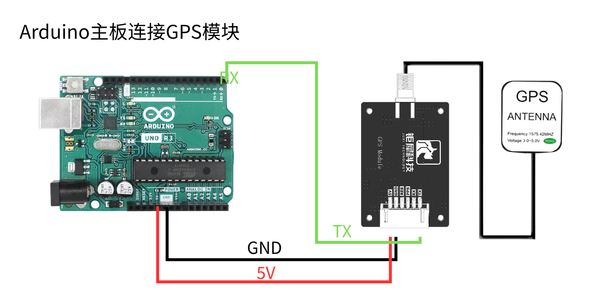
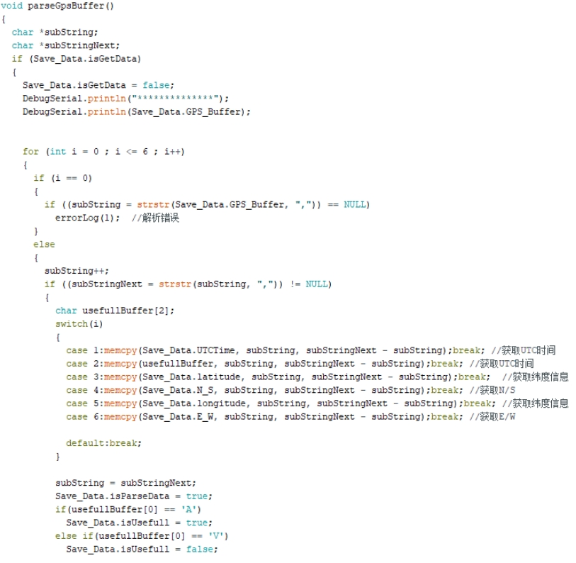
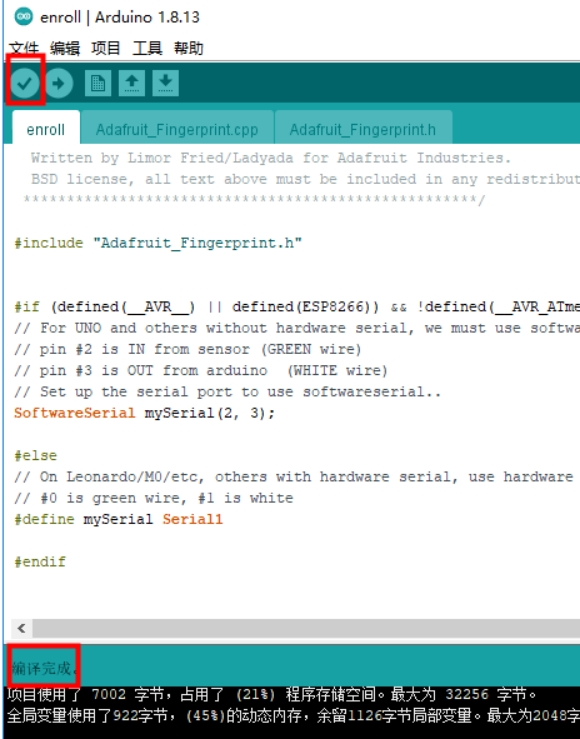
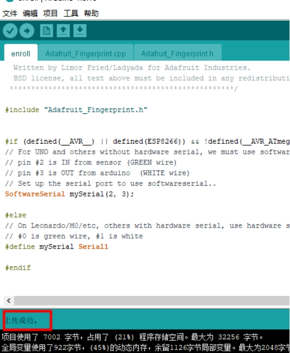

[English](../../en/04-arduino-position-parse/position-parse.md) | Deutsch | [Español](../../es/04-arduino-position-parse/position-parse.md) | [Français](../../fr/04-arduino-position-parse/position-parse.md) | [Italiano](../../it/04-arduino-position-parse/position-parse.md) | [日本語](../../ja/04-arduino-position-parse/position-parse.md) | [한국어](../../ko/04-arduino-position-parse/position-parse.md) | [Português (BR)](../../pt-br/04-arduino-position-parse/position-parse.md) | [Português (PT)](../../pt-pt/04-arduino-position-parse/position-parse.md) | [简体中文](../../zh-hans/04-arduino-position-parse/position-parse.md) | [繁體中文](../../zh-hant/04-arduino-position-parse/position-parse.md)

**GPS-Positionsdaten auswerten**

**1. Ziele**

In dieser Lektion verwenden wir einen Arduino und das GPS-Modul, um Positionsinformationen auszuwerten und auszugeben.

**2. Vorbereitung**

Das GPS-Modul kommuniziert über UART und USB. Hier verwenden wir den UART des Arduino UNO: Verbinden Sie den TX des Moduls mit Pin D0 des UNO und VCC sowie GND mit 5 V und GND.

**3. Programm**

Initialisieren Sie die serielle Schnittstelle.

Lesen Sie die seriellen Daten.

Werten Sie die seriellen Daten aus.

Geben Sie die ausgewerteten Positionsinformationen aus.

**4. Kompilieren und Hochladen**

4.1 Öffnen Sie die Datei in der Arduino IDE, klicken Sie auf die Schaltfläche "✓" zum Kompilieren und warten Sie auf "Done compiling".

4.2 Wählen Sie im Menü Werkzeuge → Port → den im Geräte-Manager angezeigten Port.

4.3 Klicken Sie auf die Schaltfläche "→", um hochzuladen. Wenn "Done uploading" erscheint, war der Upload erfolgreich.

**5. Ergebnis**

Nach dem Einschalten benötigt das Modul etwa 32 s, um zu starten; danach blinkt die serielle Status-LED kontinuierlich und Daten können normal empfangen werden.

Führen Sie das Programm aus, öffnen Sie den seriellen Monitor mit 9600 Baud, und die ausgewerteten Positionsinformationen in Echtzeit werden in einer Schleife ausgegeben.

Beachten Sie, dass die Antenne des Moduls im Freien angebracht sein muss, da sonst möglicherweise kein GPS-Signal empfangen wird.
