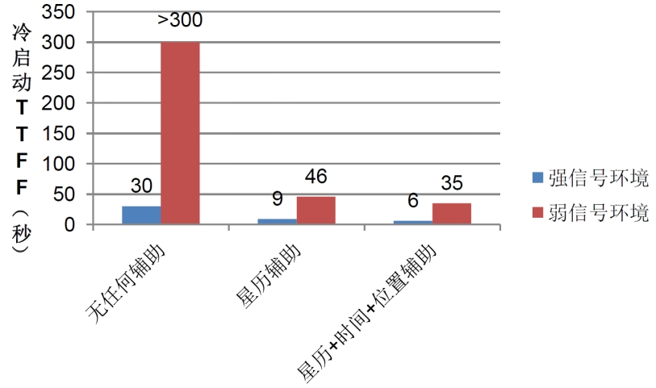
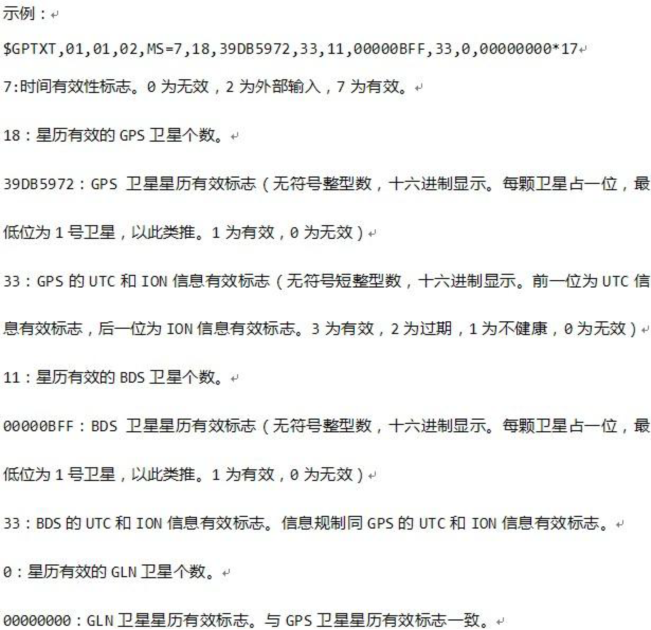
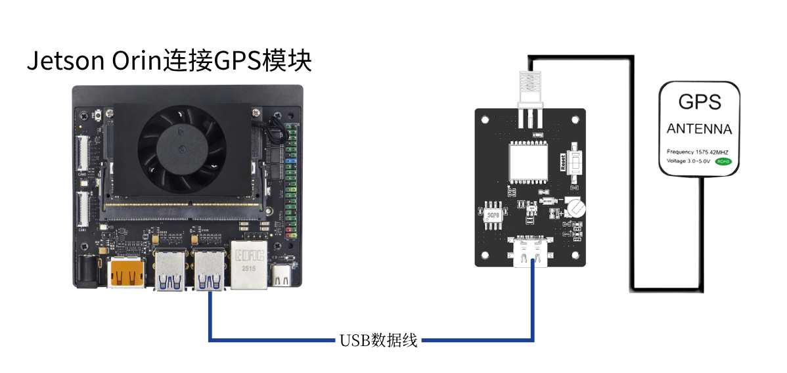
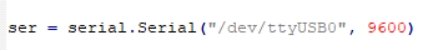
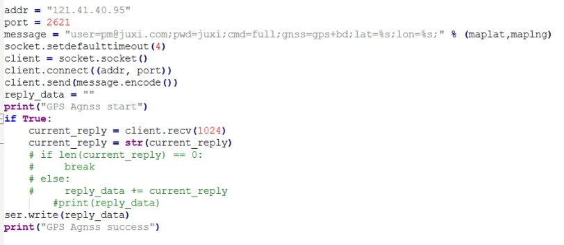
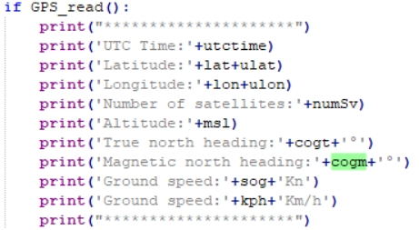
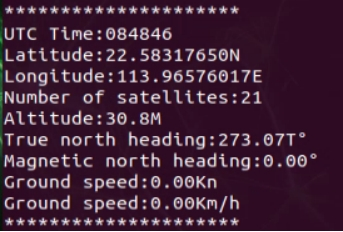

[English](../../en/07-jetson-nano-agnss/agnss.md) | Deutsch | [Español](../../es/07-jetson-nano-agnss/agnss.md) | [Français](../../fr/07-jetson-nano-agnss/agnss.md) | [Italiano](../../it/07-jetson-nano-agnss/agnss.md) | [日本語](../../ja/07-jetson-nano-agnss/agnss.md) | [한국어](../../ko/07-jetson-nano-agnss/agnss.md) | [Português (BR)](../../pt-br/07-jetson-nano-agnss/agnss.md) | [Português (PT)](../../pt-pt/07-jetson-nano-agnss/agnss.md) | [简体中文](../../zh-hans/07-jetson-nano-agnss/agnss.md) | [繁體中文](../../zh-hant/07-jetson-nano-agnss/agnss.md)

**AGNSS-unterstützte Positionsbestimmung**

**1. Ziele**

In dieser Lektion verwenden wir einen Jetson Orin, das GPS-Modul und einen AGNSS-Server, um Positionsinformationen bei schwachem Signal zu lesen und auszuwerten.

**2. Über AGNSS**

2.1 **Warum AGNSS**

- Ein eigenständiger GNSS-Empfänger muss Satellitensignale akquirieren und verfolgen und die Navigationsnachricht dekodieren, bevor er seine Position bestimmen kann.
- In einer Umgebung mit starkem Signal kann er in etwa 30 Sekunden kaltstarten. In einer Umgebung mit schwachem Signal ist die Akquisition langsam und die Navigationsnachricht schwer zu dekodieren, sodass eine Positionsbestimmung sehr lange dauern oder nie gelingen kann.
- AGNSS versorgt den Empfänger mit der benötigten Unterstützung — Navigationsdaten, einer ungefähren Position und Zeit. Sowohl bei starkem als auch bei schwachem Signal verkürzt dies die Time to first fix (TTFF) erheblich.

2.2 **Funktionsweise**

- Ein AGNSS-Server sammelt und verwaltet Unterstützungsdaten aus mehreren GNSS-Quellen und beantwortet Client-Anfragen (die einen Benutzernamen und ein Passwort erfordern).
- Der Client ruft die Unterstützungsdaten über TCP/IP ab und leitet sie an den GNSS-Empfänger weiter.
- Sie können auch einen eigenen Proxy-Server betreiben.

2.3 **Ablauf**

- Mit dem AGNSS-Server verbinden
  - Adresse: `121.41.40.95` (Domain `www.gnss-aide.com`)
  - Port: `2621`
- Eine AGNSS-Anfrage senden
  - Anfragezeichenfolge (Benutzername und Passwort sind erforderlich):
  - `user=<your-username>;pwd=<your-password>;cmd=full;gnss=gps+bd;lat=60.0;lon=55.0;alt=0;`
- Die Unterstützungsdaten empfangen
- Sie an den Empfänger weiterleiten

2.4 **Anfrageparameter**

Die Anfrage ist eine Folge von `key=value;`-Paaren, zum Beispiel `key=value;key=value;`.

Beispiel: `user=<your-username>;pwd=<your-password>;cmd=full;gnss=gps+bd;lat=60.0;lon=55.0;alt=0;`

| Schlüssel | Wert | Erforderlich | Hinweise |
| --- | --- | --- | --- |
| **user** | string | ja | Benutzername. Es wird dringend empfohlen, eine gültige E-Mail-Adresse zu verwenden — wichtige Wartungshinweise des AGNSS-Servers werden dorthin gesendet. |
| **pwd** | string | ja | Benutzerpasswort |
| **gnss** | string | nein | Kommagetrennte GNSS-Liste; derzeit wird GPS unterstützt. Gültige Werte sind `gps`, `bds`, `glo`. `gnss=gps;` fordert GPS-Unterstützung an, `gnss=gps,bds;` fordert Unterstützung für GPS und BDS an. |
| **cmd** | string | nein | `full`: alle Informationen, einschließlich Ephemeriden, geschätzter Zeit und Position. `eph`: nur Ephemeriden. `aid`: Unterstützungszeit und -position. Standard ist `full`. |
| **lat** | number | nein | Geschätzter Breitengrad des Benutzers in Grad (-90 bis 90). Die Positionsunterstützung gibt es in zwei Formaten — lat/lon/alt oder ECEF — und Sie wählen eines davon. Das Format lat/lon/alt erfordert alle drei Felder: `lat=30;lon=120.3;alt=100;` |
| **lon** | number | nein | Geschätzter Längengrad des Benutzers in Grad (-180 bis 180). |
| **alt** | number | nein | Geschätzte Höhe des Benutzers in Metern. |
| **x** | number | nein | Geschätztes ECEF-X des Benutzers in Metern. Das ECEF-Format erfordert alle drei Felder: `x=30000;y=1111120.3;z=3345100;` |
| **y** | number | nein | Geschätztes ECEF-Y des Benutzers in Metern. |
| **z** | number | nein | Geschätztes ECEF-Z des Benutzers in Metern. |
| **pacc** | number | nein | Genauigkeit der Benutzerposition in Metern. |

2.5 **Serverantwort**

- Der Server gibt einen Datenkopf gefolgt von den Unterstützungsdaten zurück.
- Die Binärnutzlast sind die Unterstützungsdaten, die der Empfänger benötigt, und enthält ihre eigene Prüfsumme. Das Binärformat finden Sie in der Protokollspezifikation des CASIC-Empfängers.
- Den Datenkopf zusätzlich an den Empfänger weiterzuleiten, ist unproblematisch.

2.6 **Leistung**

Im Vergleich zu einem eigenständigen GNSS-Empfänger verbessert ein AGNSS-Empfänger die TTFF erheblich, insbesondere bei schwachem Signal.

2.7 **Hinweise**

- Die ungefähre Position muss auf anderem Wege ermittelt werden, zum Beispiel über:
  - ein GSM/GPRS/3G-Modul, das aus der Cell-ID eine grobe Position ableiten kann
  - WLAN oder ein anderes Funkmodul, das ebenfalls grob orten kann
- Die ungefähre Position muss auf 15 km genau sein; ein falscher Positionshinweis verschlechtert die Empfängerleistung.
- Steht keine ungefähre Position zur Verfügung, lassen Sie die Positionsfelder (lat, lon, alt, x, y, z) in der Anfrage weg — der Empfänger greift dann auf seine letzte gültige Positionsbestimmung zurück.
- Es ist nicht nötig, die eigene Ausgabe des Empfängers als ungefähre Position zu verwenden.

2.8 **Wann AGNSS benötigt wird**

Es ist nicht nötig, bei jedem Start vom Server herunterzuladen, was Bandbreite spart:

- CASIC-Chips verfügen über ein batteriegepuffertes SRAM und einen dauerhaften Backup-Flash, die empfangene Ephemeridendaten behalten.
- Im normalen Betrieb lädt der Chip fortlaufend die neuesten Ephemeriden von den Satelliten herunter.
- Sie können den Status des Empfängers abfragen, um zu entscheiden, ob ein Download nötig ist. Der Empfänger kann einen Status-Satz zur Navigationsnachricht ausgeben (standardmäßig aus; er muss konfiguriert werden).

2.9 **Der Status-Satz zur Navigationsnachricht**

- Dieser Satz meldet die interne Zeit des Empfängers und den Status der Navigationsnachricht.
- Senden Sie `$PCAS03,,,,,,,,,,,1*1F`, um ihn einmal pro Sekunde auszugeben.
- Senden Sie `$PCAS03,,,,,,,,,,,0*1E`, um die Ausgabe zu beenden.
- Hinweis: Jeder Satz muss mit `\r\n` (0x0D, 0x0A) enden und enthält 11 Kommas.
- Ist das Zeitflag gültig (ungleich null) und die Anzahl gültiger Ephemeriden groß (mehr als 8), ist kein Download von AGNSS-Ephemeriden nötig.

**3. Vorbereitung**

**3.1 Verkabelung**

Das GPS-Modul unterstützt Kommunikation über UART oder USB; hier verwenden wir USB.

Verbinden Sie den Jetson Orin mit einem Type-C-Kabel mit dem GPS-Modul und führen Sie dann `ls /dev | grep 'ttyUSB'` aus — das Modul wird als `USB0` erkannt.

**3.2 Einen Baidu-Maps-AK beschaffen**

Siehe [Beantragen eines Baidu-Maps-API-Schlüssels](baidu-map-api-key.md).

**4. Programm**

Das Programm für diese Lektion ist `GPS-agnss.py`.

USB initialisieren:

Tragen Sie den von Ihnen beantragten AK ein, und der aktuelle ungefähre Breiten- und Längengrad lässt sich dann aus Baidu Maps auslesen.

Die ungefähren Koordinaten aus Baidu Maps werden an den Server gesendet — verwenden Sie Ihr eigenes AGNSS-Konto — und sobald dies abgeschlossen ist, wird das gesamte Paket an das Modul gesendet.

Die Funktion zum Erfassen und Auswerten der Position filtert die eingehenden Daten nach Sätzen, die mit `GNGGA` beginnen, und wertet sie in globale Variablen aus.

Auf dieselbe Weise werden die Kursinformationen aus `GNVTG` gelesen und ausgewertet.

Die ausgewerteten Daten werden in einer Schleife ausgegeben.

**5. Programm ausführen**

Führen Sie `sudo python2 GPS-agnss.py` in einem Terminal aus.

**6. Ergebnis**

**Hinweis: Bei der unterstützten Positionsbestimmung muss der Jetson Orin über Netzwerkzugriff verfügen.**

Nach dem Einschalten in einer Umgebung mit schwachem Signal initialisiert das Programm USB und gibt bei Erfolg `GPS Serial Opened! Baudrate=9600` aus, bei Fehlschlag `GPS Serial Open Failed!` — schlägt es fehl, prüfen Sie die Verkabelung oder den USB-Port.

Anschließend gibt es `GPS Agnss start` aus, während es die Unterstützungsdaten an den Server sendet, und `GPS Agnss success`, wenn dies abgeschlossen ist.

Bis ein GPS-Signal erfasst wird, gibt es `GPS no found` zusammen mit den aus Baidu Maps ausgelesenen ungefähren Koordinaten aus.

Sobald das Signal erfasst ist, gibt es Positions- und Kursinformationen in einer Schleife aus.

Drücken Sie Ctrl+C, um das Lesen zu beenden.
