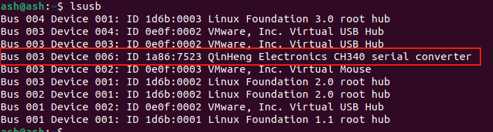

[English](../../en/10-ros-preparation/01-preparation.md) | Deutsch | [Español](../../es/10-ros-preparation/01-preparation.md) | [Français](../../fr/10-ros-preparation/01-preparation.md) | [Italiano](../../it/10-ros-preparation/01-preparation.md) | [日本語](../../ja/10-ros-preparation/01-preparation.md) | [한국어](../../ko/10-ros-preparation/01-preparation.md) | [Português (BR)](../../pt-br/10-ros-preparation/01-preparation.md) | [Português (PT)](../../pt-pt/10-ros-preparation/01-preparation.md) | [简体中文](../../zh-hans/10-ros-preparation/01-preparation.md) | [繁體中文](../../zh-hant/10-ros-preparation/01-preparation.md)

### Bevor Sie beginnen

#### 1. Die GPS-Pakete bauen

(1) Erstellen Sie einen Workspace, kopieren Sie den Inhalt des Ordners `gps_src` in das Verzeichnis `src` des Workspace und bauen Sie anschließend mit `colcon build`. Erscheinen keine Fehler, war der Build erfolgreich.

In `~/gps_ros2`:

```
colcon build
```

Dann in `~/gps_ros2`:

```
source install/setup.bash
```

(2) Was die einzelnen Pakete enthalten:

- `nmea_navsat_driver` — Starten des GPS-Moduls, Lesen seiner Daten und Zeichnen von GPS-Trajektorien
- `nmea_msgs` — Nachrichtendefinitionen für GPS-bezogene Nachrichten
- `imu_gps_localization` — Fusion von IMU- und GPS-Daten
- `gps_goal` — Umrechnung von Breiten-/Längengrad in ein Nav2-Ziel

#### 2. Einen festen Port an das GPS-Modul binden

Das GPS-Modul kommuniziert über eine serielle Schnittstelle mit dem PC oder Host, daher binden wir einen festen Portnamen daran — andernfalls kann eine sich ändernde Portnummer dazu führen, dass der Host das Modul nicht mehr findet.

(1) Listen Sie die angeschlossenen USB-Geräte auf und lokalisieren Sie das GPS-Modul. Führen Sie **lsusb** aus und notieren Sie sich die Geräte-ID, wie unten gezeigt.



(2) Schreiben Sie, nachdem die Geräte-ID bekannt ist, eine udev-Regeldatei, um den Port zu binden. Führen Sie aus:

```
sudo gedit /etc/udev/rules.d/my_serial.rules
```

und fügen Sie Folgendes ein:

```
KERNEL=="ttyUSB*", ATTRS{idVendor}=="1a86", ATTRS{idProduct}=="7523", MODE:="0777", SYMLINK+="myserial"
```

Speichern, beenden, dann ausführbar machen:

```
sudo chmod 777 /etc/udev/rules.d/my_serial.rules
```

(3) Ziehen Sie das GPS-Modul ab und stecken Sie es wieder an, und führen Sie dann `ll /dev/myserial` aus, um zu prüfen, ob die Bindung funktioniert hat. Die folgende Ausgabe bedeutet, dass es erfolgreich war.

```
ll /dev/myserial
```


