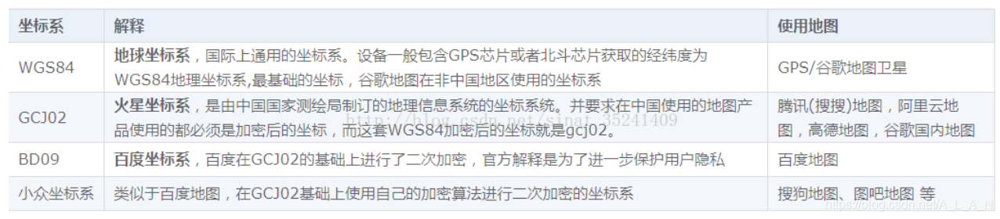
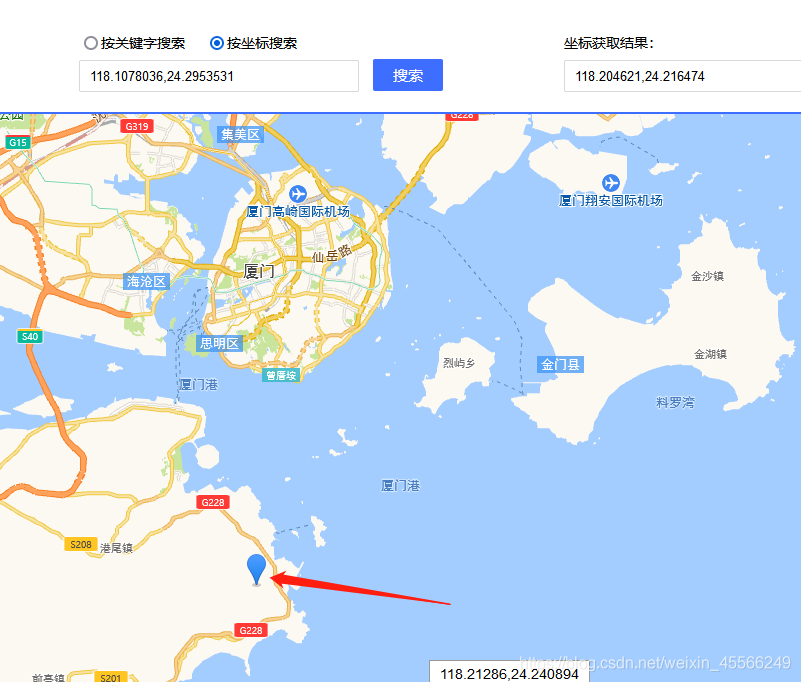
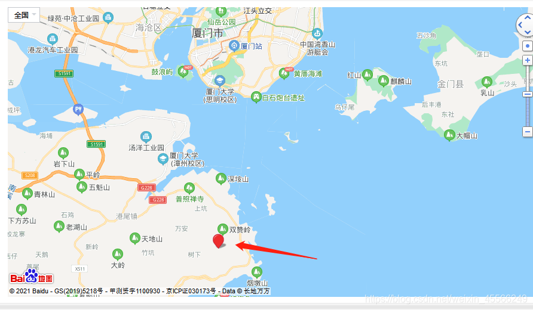

[English](../../en/15-map-position-error/map-position-error.md) | Deutsch | [Español](../../es/15-map-position-error/map-position-error.md) | [Français](../../fr/15-map-position-error/map-position-error.md) | [Italiano](../../it/15-map-position-error/map-position-error.md) | [日本語](../../ja/15-map-position-error/map-position-error.md) | [한국어](../../ko/15-map-position-error/map-position-error.md) | [Português (BR)](../../pt-br/15-map-position-error/map-position-error.md) | [Português (PT)](../../pt-pt/15-map-position-error/map-position-error.md) | [简体中文](../../zh-hans/15-map-position-error/map-position-error.md) | [繁體中文](../../zh-hant/15-map-position-error/map-position-error.md)

# Karten-Positionsfehler

## Vorwort

Tencent Maps und Amap verwenden ein anderes Koordinatensystem als das Host-Tool. Unser Host-Tool ruft die Tianditu-API (WGS-84) auf, daher weichen die umgerechneten Daten ab. Nachdem Sie GPS-/BeiDou-Positionsdaten erhalten haben, müssen Sie sie in die Koordinaten von Tianditu (WGS-84) umrechnen, bevor Sie irgendetwas anderes damit tun.

## Gängige Koordinatensysteme

    WGS-84 (GPS)
    Der internationale Standard. Koordinaten von Standard-GPS-Geräten und die von
    internationalen Kartenanbietern verwendeten sind WGS-84.

    GCJ-02
    Der chinesische Standard, 2002 vom Staatlichen Amt für Vermessung und Kartographie
    veröffentlicht. Auch als "Mars-Koordinaten" bezeichnet. Innerhalb Chinas muss eine
    geografische Position mindestens einmal mit GCJ-02 verschlüsselt werden. Google China,
    Amap und Tencent Maps verwenden ihn alle.

    BD-09
    Der Baidu-Standard: eine zweite Verschlüsselung, die zusätzlich auf GCJ-02 angewendet wird.



## BeiDou-Koordinaten

Wenn Sie mit einem BeiDou-Positionsbestimmungssystem gearbeitet haben, ist Ihnen vielleicht etwas Merkwürdiges aufgefallen: Breiten- und Längengrad scheinen mit 100 multipliziert worden zu sein.

```
$GNRMC,083735.000,A,2429.53531,N,11810.78036,E,0.54,171.11,190621,A*7E
```

Dies ist der Koordinatenwert, den der BeiDou-Empfänger meldet: Breitengrad `2429.53531` N, Längengrad `11810.78036` E. Wenn Sie einfach durch 100 teilen, erhalten Sie 24.2953531 N / 118.1078036 E — und die Position ist bei der Suche in Baidu oder Amap völlig daneben.

Amap:



Baidu Maps:



Beide weichen um Dutzende Kilometer ab. Der Grund ist, dass innerhalb Chinas sowohl Amap als auch Baidu *verschlüsselte* Breiten-/Längengradwerte statt der rohen GPS-Koordinaten verwenden. Um BeiDou-Koordinaten auf einer kommerziellen Karte zu nutzen, müssen Sie sie also zuerst durch die passende Verschlüsselung laufen lassen.

## Umrechnung zwischen Koordinatensystemen

Zunächst ein wichtiger Punkt: Der BeiDou-Koordinatenwert steht **nicht** in einem einfachen ×100-Verhältnis — er erfordert eine Umrechnung von Grad und Minuten. Für den Breitengrad `2429.53531` N und den Längengrad `11810.78036` E:

```
24 + (29.53531 / 60) ≈ 24.49225517
118 + (10.78036 / 60) ≈ 118.17967267
```

Diese beiden Werte sind die, die Sie in die Umrechnungsformeln einsetzen. Eine direkte Umrechnung aus dem ×100-Wert ergibt ebenfalls eine falsche Position, daher rechnen Sie zuerst in WGS-84 um.

```python
def str_To_Gps84(self, in_data1, in_data2):
    len_data1 = len(in_data1)
    str_data2 = "%05d" % int(in_data2)
    temp_data = int(in_data1)
    symbol = 1
    if temp_data < 0:
        symbol = -1
    degree = int(temp_data / 100.0)
    str_decimal = str(in_data1[len_data1-2]) + str(in_data1[len_data1-1]) + '.' + str(str_data2)
    f_degree = float(str_decimal)/60.0
    # print("f_degree:", f_degree)
    if symbol > 0:
        result = degree + f_degree
    else:
        result = degree - f_degree
    return result
```

WGS-84 nach GCJ-02:

```python
def gps84_to_gcj02(self, lat, lon):
    if (self.outOfChina(lat, lon)):
        return [0, 0]
    dLat = self.transformLat(lon - 105.0, lat - 35.0)
    dLon = self.transformLon(lon - 105.0, lat - 35.0)
    radLat = lat / 180.0 * self.PI
    magic = math.sin(radLat)
    magic = 1 - self.EE * magic * magic
    sqrtMagic = math.sqrt(magic)
    dLat = (dLat * 180.0)/((self.A * (1 - self.EE))/(magic * sqrtMagic) * self.PI)
    dLon = (dLon * 180.0) / (self.A / sqrtMagic * math.cos(radLat) * self.PI)
    mgLat = lat + dLat
    mgLon = lon + dLon
    return [mgLat, mgLon]
```

GCJ-02 nach BD-09:

```python
def gcj02_to_bd09(self, gg_lat, gg_lon):
    x = gg_lon
    y = gg_lat
    z = math.sqrt(x * x + y * y) + 0.00002 * math.sin(y * self.PI)
    theta = math.atan2(y, x) + 0.000003 * math.cos(x * self.PI)
    bd_lon = z * math.cos(theta) + 0.0065
    bd_lat = z * math.sin(theta) + 0.006
    return [bd_lat, bd_lon]
```

Weitere dazwischen verwendete Hilfsfunktionen und Konstanten:

```python
self.PI = 3.1415926535897932384626
self.A = 6378245.0
self.EE = 0.00669342162296594323

def outOfChina(self, lat, lon):
    if (lon < 72.004 or lon > 137.8347):
        return True
    if (lat < 0.8293 or lat > 55.8271):
        return True
    return False

def transform(self, lat, lon):
    if (self.outOfChina(lat, lon)):
        return [lat, lon]
    dLat = self.transformLat(lon - 105.0, lat - 35.0)
    dLon = self.transformLon(lon - 105.0, lat - 35.0)
    radLat = lat / 180.0 * self.PI
    magic = math.sin(radLat)
    magic = 1 - self.EE * magic * magic
    sqrtMagic = math.sqrt(magic)
    dLat = (dLat * 180.0) / ((self.A * (1 - self.EE)) / (magic * sqrtMagic) *self.PI)
    dLon = (dLon * 180.0) / (self.A / sqrtMagic * math.cos(radLat) * self.PI)
    mgLat = lat + dLat
    mgLon = lon + dLon
    return [mgLat, mgLon]

def transformLat(self, x, y):
    ret = -100.0 + 2.0 * x + 3.0 * y + 0.2 * y * y + 0.1 * x * y + 0.2 * math.sqrt(abs(x))
    ret += (20.0 * math.sin(6.0 * x * self.PI) + 20.0 * math.sin(2.0 * x * self.PI)) * 2.0 / 3.0
    ret += (20.0 * math.sin(y * self.PI) + 40.0 * math.sin(y / 3.0 * self.PI)) * 2.0 / 3.0
    ret += (160.0 * math.sin(y / 12.0 * self.PI) + 320 * math.sin(y * self.PI / 30.0)) * 2.0 / 3.0
    return ret

def transformLon(self, x, y):
    ret = 300.0 + x + 2.0 * y + 0.1 * x * x + 0.1 * x * y + 0.1 * math.sqrt(abs(x))
    ret += (20.0 * math.sin(6.0 * x * self.PI) + 20.0 * math.sin(2.0 * x * self.PI)) * 2.0 / 3.0
    ret += (20.0 * math.sin(x * self.PI) + 40.0 * math.sin(x / 3.0 * self.PI)) * 2.0 / 3.0
    ret += (150.0 * math.sin(x / 12.0 * self.PI) + 300.0 * math.sin(x / 30.0 * self.PI)) * 2.0 / 3.0
    return ret
```

Für Amap verwenden Sie das GCJ-02-Ergebnis; für Baidu Maps das BD-09-Ergebnis.

## Zusammenfassung

Google Maps und ähnliche verwenden das WGS-84-System. BeiDou-Koordinaten benötigen eine Umrechnung von Grad und Minuten, um WGS-84 zu werden. Amap und ähnliche verwenden das GCJ-02-"Mars"-System, daher benötigen die Koordinaten eine GCJ-02-Verschlüsselung, bevor Amap sie nutzen kann. Baidu Maps benötigt zusätzlich eine weitere BD-09-Verschlüsselung.
