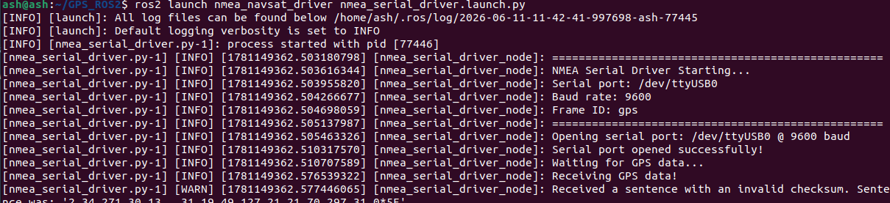
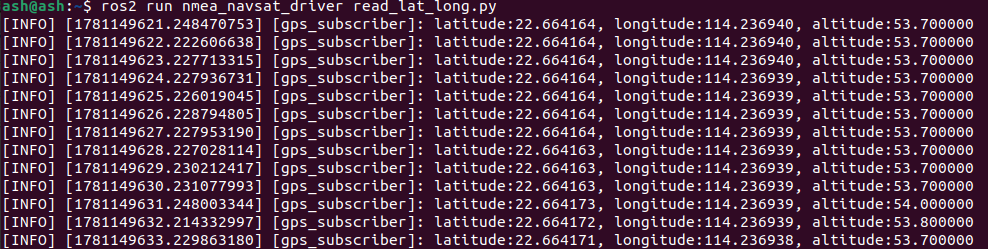

[English](../../en/11-ros-read-gps-data/02-read-gps-data.md) | [Deutsch](../../de/11-ros-read-gps-data/02-read-gps-data.md) | Español | [Français](../../fr/11-ros-read-gps-data/02-read-gps-data.md) | [Italiano](../../it/11-ros-read-gps-data/02-read-gps-data.md) | [日本語](../../ja/11-ros-read-gps-data/02-read-gps-data.md) | [한국어](../../ko/11-ros-read-gps-data/02-read-gps-data.md) | [Português (BR)](../../pt-br/11-ros-read-gps-data/02-read-gps-data.md) | [Português (PT)](../../pt-pt/11-ros-read-gps-data/02-read-gps-data.md) | [简体中文](../../zh-hans/11-ros-read-gps-data/02-read-gps-data.md) | [繁體中文](../../zh-hant/11-ros-read-gps-data/02-read-gps-data.md)

### Lectura de datos del módulo GPS

**Esta función lee los datos GPS desde un terminal y los analiza para obtener latitud, longitud y altitud.**

#### 1. Lectura de datos GPS desde un terminal

En un terminal:

```
ros2 launch nmea_navsat_driver nmea_serial_driver.launch.py
```



Ahora consulta los topics:

```
ros2 topic list
```


Una nota sobre los topics de GPS:

| Topic | Tipo | Descripción |
| --- | --- | --- |
| `/extend_fix` | `gps_common/GPSFix` | Mensaje GPSFix con el estado de los satélites y la información del fix |
| `/fix` | `sensor_msgs/NavSatFix` | Información del fix de GPS |
| `/time_reference` | `sensor_msgs/TimeReference` | Información de la hora GPS |
| `/vel` | `geometry_msgs/TwistStamped` | Velocidad GPS |

Las definiciones de los mensajes están documentadas en:

[Documentación de sensor_msgs/NavSatFix (ros.org)](http://docs.ros.org/en/api/sensor_msgs/html/msg/NavSatFix.html)

[Documentación de sensor_msgs/TimeReference (ros.org)](http://docs.ros.org/en/api/sensor_msgs/html/msg/TimeReference.html)

[Documentación de geometry_msgs/TwistStamped (ros.org)](http://docs.ros.org/en/api/geometry_msgs/html/msg/TwistStamped.html)

Puedes imprimir estos mensajes de topic en un terminal; lo que obtienes son los datos GPS. Por ejemplo, para imprimir `/fix`:

```
ros2 topic echo /fix
```

El terminal muestra:


Aquí `latitude`, `longitude` y `altitude` son la latitud, la longitud y la altitud.

#### 2. Lectura de latitud, longitud y altitud

En un terminal:

```
ros2 launch nmea_navsat_driver nmea_serial_driver.launch.py
```

En otro terminal:

```
ros2 run nmea_navsat_driver read_lat_long.py
```



Los datos impresos son la latitud, la longitud y la altitud actuales. Echa un vistazo al código fuente, `read_lat_long.py`:

```python
#! /usr/bin/env python3
# -*- coding: utf-8 -*-
import rclpy
from rclpy.node import Node
from sensor_msgs.msg import NavSatFix

class GPSSubscriber(Node):
    def __init__(self):
        super().__init__('GPS_subscriber')
        self.subscription = self.create_subscription(
            NavSatFix,
            '/fix',
            self.gps_callback,
            10)
        self.subscription

    def gps_callback(self, msg):
        self.get_logger().info(f"latitude:{msg.latitude:.6f}, longitude:{msg.longitude:.6f}, altitude:{msg.altitude:.6f}")

def main(args=None):
    rclpy.init(args=args)
    gps_subscriber = GPSSubscriber()
    rclpy.spin(gps_subscriber)
    gps_subscriber.destroy_node()
    rclpy.shutdown()

if __name__ == '__main__':
    main()
```

El programa se suscribe a `/fix`, analiza el mensaje en la función de callback y lo imprime en el terminal.
