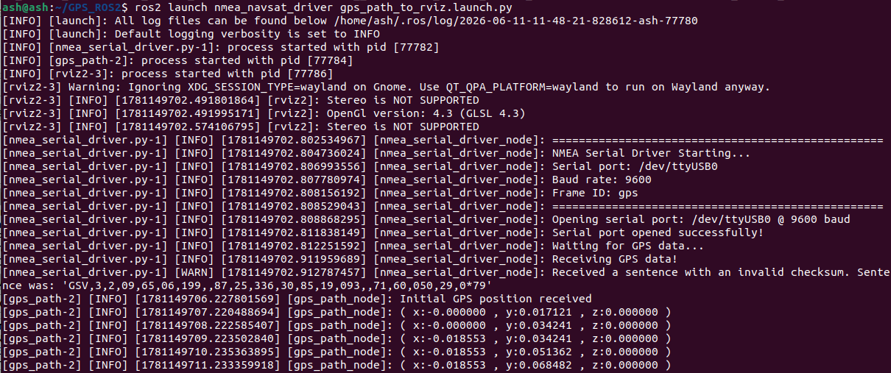
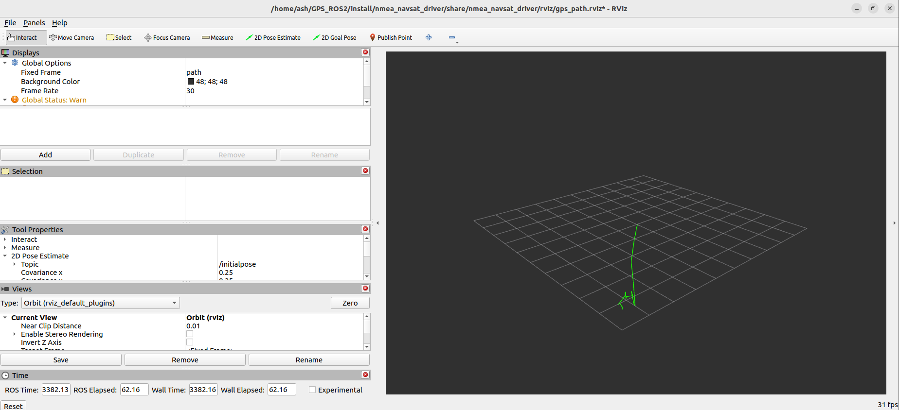

[English](../../en/12-ros-plot-gps-track/03-plot-gps-track.md) | [Deutsch](../../de/12-ros-plot-gps-track/03-plot-gps-track.md) | Español | [Français](../../fr/12-ros-plot-gps-track/03-plot-gps-track.md) | [Italiano](../../it/12-ros-plot-gps-track/03-plot-gps-track.md) | [日本語](../../ja/12-ros-plot-gps-track/03-plot-gps-track.md) | [한국어](../../ko/12-ros-plot-gps-track/03-plot-gps-track.md) | [Português (BR)](../../pt-br/12-ros-plot-gps-track/03-plot-gps-track.md) | [Português (PT)](../../pt-pt/12-ros-plot-gps-track/03-plot-gps-track.md) | [简体中文](../../zh-hans/12-ros-plot-gps-track/03-plot-gps-track.md) | [繁體中文](../../zh-hant/12-ros-plot-gps-track/03-plot-gps-track.md)

### Representación de una trayectoria GPS

**Esta función representa datos GPS en tiempo real y los muestra en rviz2.**

#### 1. Cómo funciona

Los datos GPS no pueden visualizarse directamente, por lo que transformamos el sistema de coordenadas: la trayectoria se convierte de latitud/longitud WGS-84 a un sistema xyz del mundo real. Con coordenadas xyz del mundo real podemos mostrar el recorrido en rviz2 y simular la trayectoria GPS. La trayectoria se acumula tomando el desplazamiento de cada coordenada GPS respecto a la primera coordenada y sumándolos.

#### 2. Ejecución

En un terminal:

```
ros2 launch nmea_navsat_driver gps_path_to_rviz.launch.py
```



En la ventana de rviz2 puedes ver cómo la línea verde se va extendiendo gradualmente, como se muestra a continuación.



#### 3. El archivo launch

```python
from launch import LaunchDescription
from launch.actions import DeclareLaunchArgument
from launch.substitutions import LaunchConfiguration
from launch_ros.actions import Node
from ament_index_python.packages import get_package_share_directory
import os

def generate_launch_description():
    port_arg = DeclareLaunchArgument('port', default_value='/dev/myserial')
    baud_arg = DeclareLaunchArgument('baud', default_value='9600')
    frame_id_arg = DeclareLaunchArgument('frame_id', default_value='gps')
    time_ref_source_arg = DeclareLaunchArgument('time_ref_source', default_value='gps')
    useRMC_arg = DeclareLaunchArgument('useRMC', default_value='False')

    port = LaunchConfiguration('port')
    baud = LaunchConfiguration('baud')
    frame_id = LaunchConfiguration('frame_id')
    time_ref_source = LaunchConfiguration('time_ref_source')
    useRMC = LaunchConfiguration('useRMC')

    nmea_serial_driver_node = Node(
        package='nmea_navsat_driver',
        executable='nmea_serial_driver',
        name='nmea_serial_driver_node',
        output='screen',
        parameters=[{
            'port': port,
            'baud': baud,
            'frame_id': frame_id,
            'time_ref_source': time_ref_source,
            'useRMC': useRMC
        }]
    )

    gps_path_node = Node(
        package='nmea_navsat_driver',
        executable='Draw_GPS_Path',
        name='gps_path_node',
        output='screen'
    )

    rviz_config = os.path.join(
        get_package_share_directory('nmea_navsat_driver'),
        'rviz',
        'gps_path.rviz'
    )

    rviz_node = Node(
        package='rviz2',
        executable='rviz2',
        name='rviz2',
        arguments=['-d', rviz_config]
    )

    return LaunchDescription([
        port_arg,
        baud_arg,
        frame_id_arg,
        time_ref_source_arg,
        useRMC_arg,
        nmea_serial_driver_node,
        gps_path_node,
        rviz_node
    ])
```

Se inician tres nodos: `nmea_serial_driver_node` lee los datos GPS, `gps_path_node` dibuja la trayectoria GPS y `rviz2` la muestra.

El código fuente de `gps_path_node` es `gps_path.cpp`, en `nmea_navsat_driver/src`; merece la pena echarle un vistazo.
