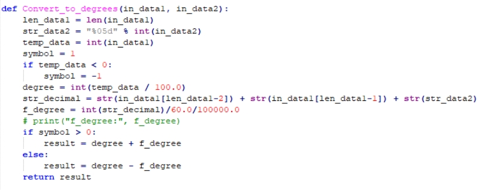
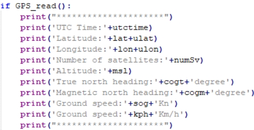

[English](../../en/08-raspberry-pi-position-parse/position-parse.md) | [Deutsch](../../de/08-raspberry-pi-position-parse/position-parse.md) | [Español](../../es/08-raspberry-pi-position-parse/position-parse.md) | Français | [Italiano](../../it/08-raspberry-pi-position-parse/position-parse.md) | [日本語](../../ja/08-raspberry-pi-position-parse/position-parse.md) | [한국어](../../ko/08-raspberry-pi-position-parse/position-parse.md) | [Português (BR)](../../pt-br/08-raspberry-pi-position-parse/position-parse.md) | [Português (PT)](../../pt-pt/08-raspberry-pi-position-parse/position-parse.md) | [简体中文](../../zh-hans/08-raspberry-pi-position-parse/position-parse.md) | [繁體中文](../../zh-hant/08-raspberry-pi-position-parse/position-parse.md)

**Lecture et analyse des données de position GPS (Raspberry Pi)**

**1. Objectifs**

Dans cette leçon, nous utilisons un Raspberry Pi et le module GPS pour lire et analyser les informations de position.

**2. Préparation**

Le module GPS prend en charge la communication UART ou USB ; ici, nous utilisons l'USB.

Reliez le Raspberry Pi au module GPS avec un câble Type-C, puis exécutez `ls /dev | grep 'ttyUSB'` — le module est détecté sous `USB0`.

**3. Programme**

Le programme de cette leçon est `GPS.py`.

Initialisez l'USB :

La fonction d'acquisition et d'analyse de position filtre les données entrantes pour les trames commençant par `GNGGA` et les analyse dans des variables globales.

La même approche lit et analyse les informations de cap à partir de `GNVTG`.

Les données analysées sont affichées en boucle.

**4. Exécution du programme**

Exécutez `sudo python2 GPS.py` dans un terminal.

**5. Résultat**

Après la mise sous tension, le module a besoin d'environ 32 s pour démarrer ; ensuite, la LED d'état série clignote en continu et les données peuvent être reçues normalement.

Au démarrage, le programme initialise l'USB et affiche `GPS Serial Opened! Baudrate=9600` en cas de succès, ou `GPS Serial Open Failed!` en cas d'échec — en cas d'échec, vérifiez le câblage ou le port USB. Il affiche ensuite les informations de position et de cap en boucle.

Appuyez sur Ctrl+C pour arrêter la lecture.

Notez que l'antenne du module doit être à l'extérieur, sinon il risque de ne pas capter de signal GPS — lorsqu'aucun signal n'est trouvé, il affiche `GPS no found`.
