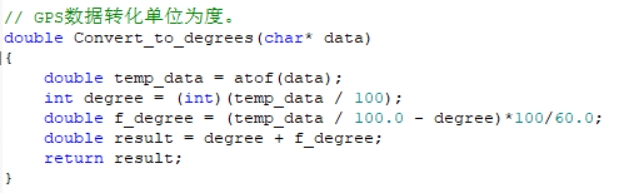
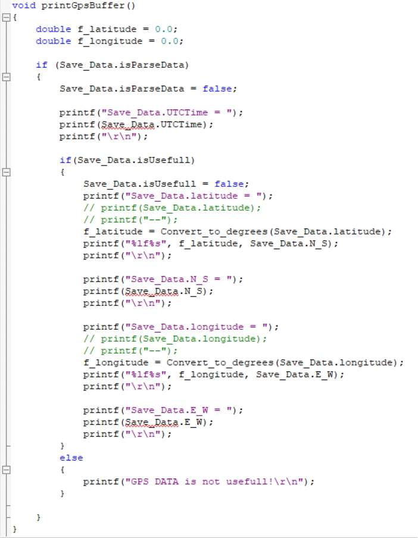
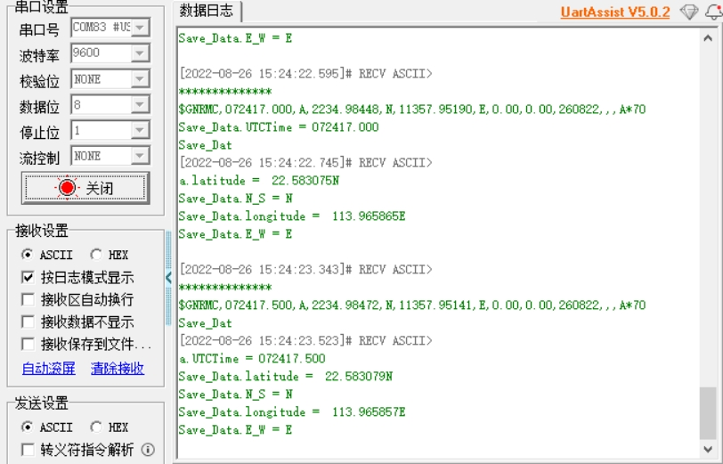

[English](../../en/05-stm32f103/gps-parse-output.md) | [Deutsch](../../de/05-stm32f103/gps-parse-output.md) | [Español](../../es/05-stm32f103/gps-parse-output.md) | [Français](../../fr/05-stm32f103/gps-parse-output.md) | Italiano | [日本語](../../ja/05-stm32f103/gps-parse-output.md) | [한국어](../../ko/05-stm32f103/gps-parse-output.md) | [Português (BR)](../../pt-br/05-stm32f103/gps-parse-output.md) | [Português (PT)](../../pt-pt/05-stm32f103/gps-parse-output.md) | [简体中文](../../zh-hans/05-stm32f103/gps-parse-output.md) | [繁體中文](../../zh-hant/05-stm32f103/gps-parse-output.md)

**Analisi e output dei dati GPS (STM32)**

**1. Obiettivi**

In questa lezione utilizziamo un STM32F103C8T6 e il modulo GPS per analizzare ed emettere le informazioni di posizione.

**2. Preparazione**

Il modulo GPS comunica tramite UART e USB. Qui utilizziamo la UART dell'STM32: collegare il TXD del modulo al pin PA10 della scheda STM32F103C8T6, e VCC e GND al 5 V e GND della scheda. Collegare GND e RXD dell'adattatore TTL al GND e al PA9 dell'STM32.


**3. Programma**

Il baud rate del modulo è 9600.


Leggere e analizzare i dati in ingresso.


Convertire le unità di latitudine / longitudine in gradi.



Stampare i dati ricevuti attraverso la porta seriale.



Nota: latitudine e longitudine da GPS / BeiDou non hanno una semplice relazione ×100 — richiedono una conversione gradi-minuti. Ad esempio, per la latitudine `2429.53531` N e la longitudine `11810.78036` E:

```
24 + (29.53531 / 60) ≈ 24.49225517
118 + (10.78036 / 60) ≈ 118.17967267
```

Microcontrollori diversi possono inoltre introdurre un piccolo errore a causa della precisione nella conversione dei dati.

**4. Risultato**

Dopo l'accensione il modulo impiega circa 32 s per avviarsi; dopodiché il LED di stato della seriale lampeggia continuamente e i dati possono essere ricevuti normalmente.

Scaricare ed eseguire il programma, aprire un terminale seriale a 9600 baud, e le informazioni sulla posizione corrente vengono stampate in un ciclo continuo.



Nota: l'antenna del modulo deve trovarsi all'aperto, altrimenti potrebbe non acquisire il segnale GPS.
