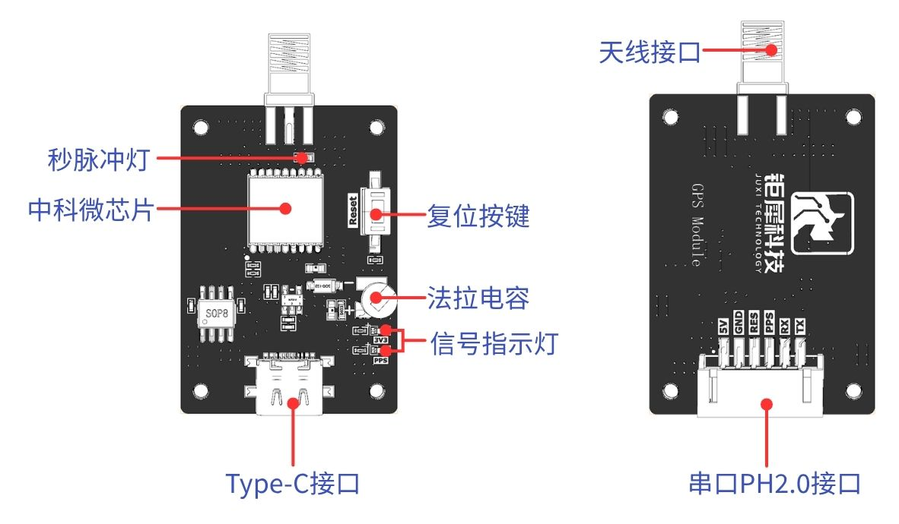

[English](../../en/01-overview/overview.md) | [Deutsch](../../de/01-overview/overview.md) | [Español](../../es/01-overview/overview.md) | [Français](../../fr/01-overview/overview.md) | [Italiano](../../it/01-overview/overview.md) | 日本語 | [한국어](../../ko/01-overview/overview.md) | [Português (BR)](../../pt-br/01-overview/overview.md) | [Português (PT)](../../pt-pt/01-overview/overview.md) | [简体中文](../../zh-hans/01-overview/overview.md) | [繁體中文](../../zh-hant/01-overview/overview.md)

# GPS モジュール

GPS モジュールは、**ATGM336H-5N** をベースにした高性能な BDS/GNSS 測位・航法モジュールです。北斗二号系（BeiDou-2）と北斗三号系（BeiDou-3）の全衛星、GPS、GLONASS、QZSS など複数の衛星測位システムに対応しており、これらを同時に受信して測位・航法・時刻同期を行うことができます。高感度・低消費電力・低コストを実現しており、車載ナビゲーション、ハンディ測位端末、ウェアラブル機器に適しています。

**1. 特長**

- 北斗二号系・北斗三号系の全衛星（ID 1～63）に対応
- BDS / GPS / QZSS の単独測位、およびそれらの任意の組み合わせに対応
- A-GNSS に対応
- コールドスタート時の捕捉感度：-148 dBm
- 追尾感度：-162 dBm
- 測位精度：2.5 m（CEP50）
- 初回測位時間：32 秒
- 低消費電力：25 mA @ 3.3 V（連続動作時）
- アンテナ検出およびアンテナ短絡保護を内蔵

**2. インターフェース**

**3. 通信プロトコル**

詳細なプロトコルは `../../datasheets/CASIC-GNSS-protocol-spec-CN.pdf`（中国語）を参照してください。
