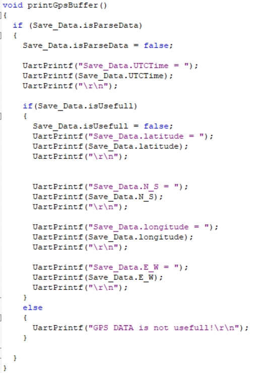
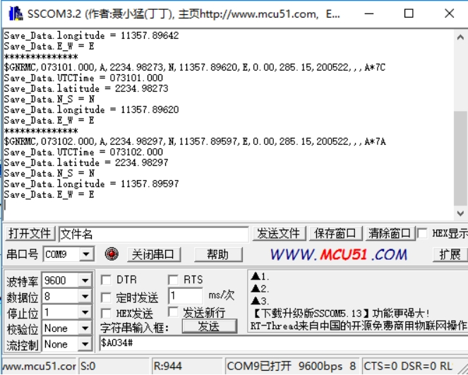

[English](../../en/02-51-microcontroller/gps-data-parsing.md) | [Deutsch](../../de/02-51-microcontroller/gps-data-parsing.md) | [Español](../../es/02-51-microcontroller/gps-data-parsing.md) | [Français](../../fr/02-51-microcontroller/gps-data-parsing.md) | [Italiano](../../it/02-51-microcontroller/gps-data-parsing.md) | 日本語 | [한국어](../../ko/02-51-microcontroller/gps-data-parsing.md) | [Português (BR)](../../pt-br/02-51-microcontroller/gps-data-parsing.md) | [Português (PT)](../../pt-pt/02-51-microcontroller/gps-data-parsing.md) | [简体中文](../../zh-hans/02-51-microcontroller/gps-data-parsing.md) | [繁體中文](../../zh-hant/02-51-microcontroller/gps-data-parsing.md)

**GPS データのパース**

**1. 目的**

本レッスンでは、STC89C52RC（8051）マイコンと GPS モジュールを使って、測位情報をパースします。

**2. 準備**

GPS モジュールは UART と USB で通信します。ここでは 8051 の UART 経由で読み取ります。モジュールの TX を 8051 ボードの P3.0 ピンに、VCC と GND を 5 V と GND に接続してください。

**3. プログラム**

シリアルポートとデータ配列を初期化します。

受信データを読み取ってパースします。

受信データをシリアルポート経由で出力します。

**4. 結果**

電源投入後、モジュールが起動するまでに約 32 秒かかります。その後はシリアルステータス LED が点滅し続け、データを正常に受信できるようになります。

プログラムを書き込んで実行し、シリアルターミナルを 9600 baud で開くと、現在の測位情報が繰り返し出力されます。

なお、モジュールのアンテナは屋外に設置する必要があります。屋内では GPS 信号を捕捉できないことがあります。
