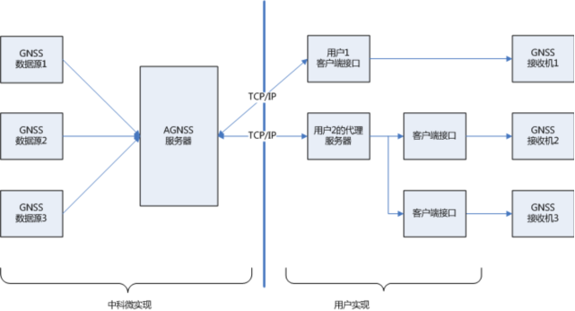
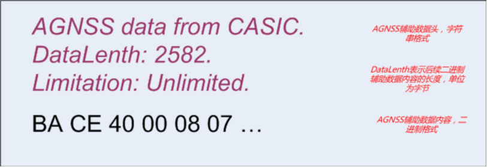
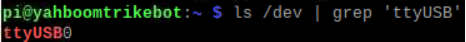
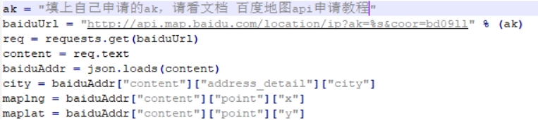
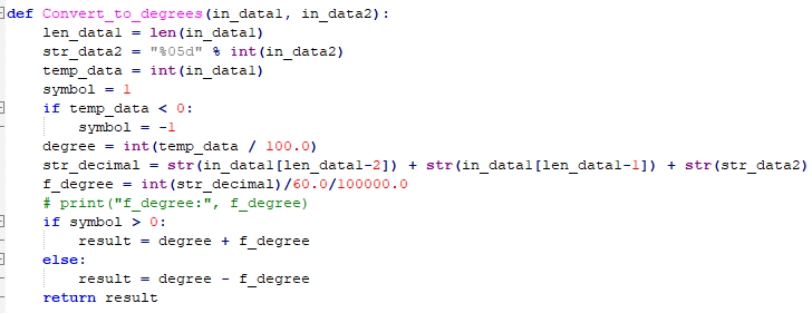
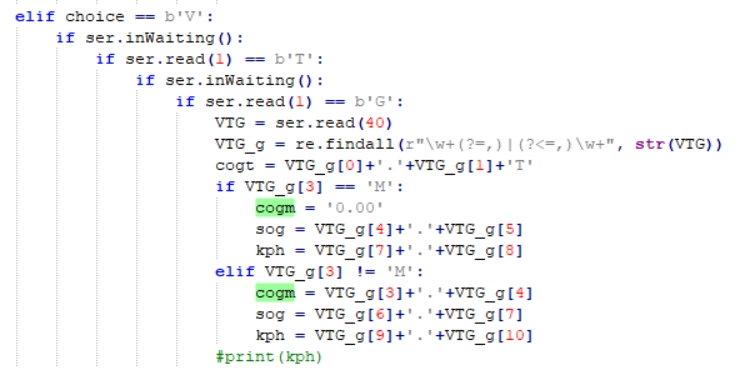
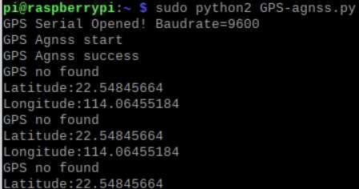
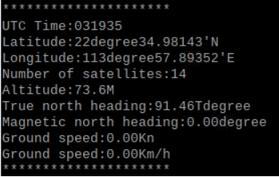
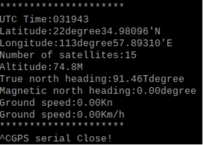

[English](../../en/09-raspberry-pi-agnss/agnss.md) | [Deutsch](../../de/09-raspberry-pi-agnss/agnss.md) | [Español](../../es/09-raspberry-pi-agnss/agnss.md) | [Français](../../fr/09-raspberry-pi-agnss/agnss.md) | [Italiano](../../it/09-raspberry-pi-agnss/agnss.md) | 日本語 | [한국어](../../ko/09-raspberry-pi-agnss/agnss.md) | [Português (BR)](../../pt-br/09-raspberry-pi-agnss/agnss.md) | [Português (PT)](../../pt-pt/09-raspberry-pi-agnss/agnss.md) | [简体中文](../../zh-hans/09-raspberry-pi-agnss/agnss.md) | [繁體中文](../../zh-hant/09-raspberry-pi-agnss/agnss.md)

**AGNSS による補助測位**

**1. 目的**

本レッスンでは、Raspberry Pi、GPS モジュール、AGNSS サーバーを使って、弱電波環境で測位情報を読み取ってパースします。

**2. AGNSS について**

2.1 **なぜ AGNSS が必要か**

- 単体の GNSS 受信機は、測位を確定する前に衛星信号を捕捉・追尾し、航法メッセージを復号する必要があります。
- 電波の強い環境では約 30 秒でコールドスタートできます。電波の弱い環境では捕捉に時間がかかり、航法メッセージの復号も困難なため、測位の確定に非常に長い時間がかかるか、まったく測位できないことがあります。
- AGNSS は受信機に必要な支援情報（航法データ、おおよその位置と時刻）を提供します。電波が強い場合も弱い場合も、初回測位時間（TTFF）を大幅に短縮します。

2.2 **仕組み**

- AGNSS サーバーは複数の GNSS ソースから支援データを収集・管理し、クライアントからのリクエスト（ユーザー名とパスワードが必要）に応答します。
- クライアントは TCP/IP 経由で支援データを取得し、GNSS 受信機へ転送します。
- 自前のプロキシサーバーを運用することもできます。

2.3 **手順**

- AGNSS サーバーに接続する
  - アドレス：`121.41.40.95`（ドメイン `www.gnss-aide.com`）
  - ポート：`2621`
- AGNSS リクエストを送信する
  - リクエスト文字列（ユーザー名とパスワードが必要）：
  - `user=<your-username>;pwd=<your-password>;cmd=full;gnss=gps+bd;lat=60.0;lon=55.0;alt=0;`
- 支援データを受信する
- 受信機へ転送する

2.4 **リクエストパラメータ**

リクエストは `key=value;` の組を並べたもので、たとえば `key=value;key=value;` のようになります。

例：`user=<your-username>;pwd=<your-password>;cmd=full;gnss=gps+bd;lat=60.0;lon=55.0;alt=0;`

| キー | 値 | 必須 | 備考 |
| --- | --- | --- | --- |
| **user** | string | はい | ユーザー名。有効なメールアドレスの使用を強く推奨します。AGNSS サーバーの重要なメンテナンス通知がそこに送信されます。 |
| **pwd** | string | はい | ユーザーパスワード |
| **gnss** | string | いいえ | カンマ区切りの GNSS リスト。現在は GPS に対応しています。有効な値は `gps`、`bds`、`glo` です。`gnss=gps;` は GPS 支援を要求し、`gnss=gps,bds;` は GPS と BDS の支援を要求します。 |
| **cmd** | string | いいえ | `full`：すべての情報（暦、推定時刻、位置を含む）。`eph`：暦のみ。`aid`：支援時刻と位置。既定値は `full` です。 |
| **lat** | number | いいえ | ユーザーの推定緯度（度、-90～90）。位置支援には lat/lon/alt 形式と ECEF 形式の 2 つがあり、どちらか一方を選びます。lat/lon/alt 形式では 3 つのフィールドすべてが必要です：`lat=30;lon=120.3;alt=100;` |
| **lon** | number | いいえ | ユーザーの推定経度（度、-180～180）。 |
| **alt** | number | いいえ | ユーザーの推定高度（メートル）。 |
| **x** | number | いいえ | ユーザーの推定 ECEF X（メートル）。ECEF 形式では 3 つのフィールドすべてが必要です：`x=30000;y=1111120.3;z=3345100;` |
| **y** | number | いいえ | ユーザーの推定 ECEF Y（メートル）。 |
| **z** | number | いいえ | ユーザーの推定 ECEF Z（メートル）。 |
| **pacc** | number | いいえ | ユーザー位置の精度（メートル）。 |

2.5 **サーバーの応答**

- サーバーはデータヘッダーに続けて支援データを返します。
- バイナリのペイロードは受信機が必要とする支援データで、独自のチェックサムを持ちます。バイナリ形式については CASIC 受信機プロトコル仕様書を参照してください。
- ヘッダーもあわせて受信機へ転送しても問題ありません。

2.6 **性能**

単体の GNSS 受信機と比べて、AGNSS 受信機は TTFF を大幅に改善します。特に電波の弱い環境で効果的です。

2.7 **注意事項**

- おおよその位置は別の方法で取得する必要があります。たとえば次のようなものがあります。
  - GSM/GPRS/3G モジュール：セル ID からおおよその位置を求めることができます
  - Wi-Fi やその他の無線モジュール：これらもおおよその測位が可能です
- おおよその位置は 15 km 以内の精度が必要です。誤った位置ヒントは受信機の性能を低下させます。
- おおよその位置が得られない場合は、リクエストから位置フィールド（lat、lon、alt、x、y、z）を省略してください。その場合、受信機は直前に有効だった測位結果を使用します。
- 受信機自身の出力をおおよその位置として使う必要はありません。

2.8 **AGNSS が必要なとき**

毎回の起動時にサーバーからダウンロードする必要はなく、帯域を節約できます。

- CASIC チップはバッテリーバックアップされた SRAM と永続的なバックアップフラッシュを持ち、受信した暦データを保持します。
- 通常動作中、チップは衛星から最新の暦を取得し続けます。
- 受信機のステータスを照会して、ダウンロードが必要かどうかを判断できます。受信機は航法メッセージのステータスセンテンスを出力できます（既定ではオフで、設定が必要です）。

2.9 **航法メッセージのステータスセンテンス**

- このセンテンスは受信機の内部時刻と航法メッセージのステータスを報告します。
- `$PCAS03,,,,,,,,,,,1*1F` を送信すると、1 秒に 1 回出力されます。
- `$PCAS03,,,,,,,,,,,0*1E` を送信すると、出力を停止します。
- 注意：すべてのセンテンスは `\r\n`（0x0D、0x0A）で終わる必要があり、カンマを 11 個含みます。
- 時刻フラグが有効（非ゼロ）で、有効な暦の数が多い（8 より大きい）場合、AGNSS の暦をダウンロードする必要はありません。

**3. 準備**

**3.1 配線**

GPS モジュールは UART または USB による通信に対応しています。ここでは USB を使用します。

Type-C ケーブルで Raspberry Pi と GPS モジュールを接続し、`ls /dev | grep 'ttyUSB'` を実行します。モジュールは `USB0` として検出されます。

**3.2 Baidu Map の AK の取得**

「[Baidu Map API キーの申請](baidu-map-api-key.md)」を参照してください。

**4. プログラム**

本レッスンのプログラムは `GPS-agnss.py` です。

USB を初期化します：

申請した AK を入力すると、現在のおおよその緯度・経度を Baidu Map から読み取れるようになります。

Baidu Map から取得したおおよその座標がサーバーへ送信されます（ご自身の AGNSS アカウントを使用してください）。完了すると、パケット全体がモジュールへ送信されます。

測位情報の取得・パース関数は、受信データから `GNGGA` で始まるセンテンスを抽出し、グローバル変数にパースします。

同様の方法で、`GNVTG` から方位情報を読み取ってパースします。

パースしたデータを繰り返し出力します。

**5. プログラムの実行**

ターミナルで `sudo python2 GPS-agnss.py` を実行します。

**6. 結果**

**注意：補助測位を使用する場合、Raspberry Pi はネットワークに接続されている必要があります。**

弱電波環境で電源投入後、プログラムは USB を初期化し、成功時は `GPS Serial Opened! Baudrate=9600`、失敗時は `GPS Serial Open Failed!` を出力します。失敗した場合は配線または USB ポートを確認してください。

続いて、支援データをサーバーへ送信中に `GPS Agnss start` を、完了時に `GPS Agnss success` を出力します。

GPS 信号を捕捉するまでは、Baidu Map から読み取ったおおよその座標とともに `GPS no found` を出力します。

信号を捕捉すると、測位情報と方位情報を繰り返し出力します。

Ctrl+C を押すと読み取りを停止します。

