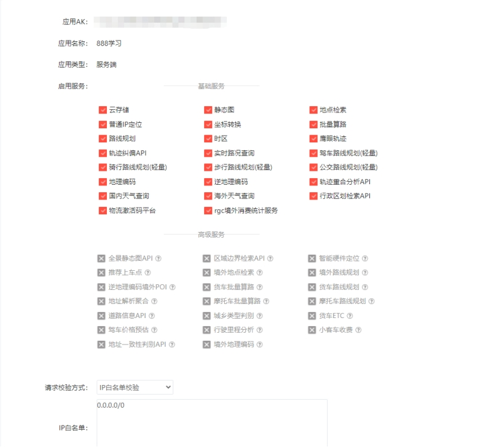

[English](../../en/07-jetson-nano-agnss/baidu-map-api-key.md) | [Deutsch](../../de/07-jetson-nano-agnss/baidu-map-api-key.md) | [Español](../../es/07-jetson-nano-agnss/baidu-map-api-key.md) | [Français](../../fr/07-jetson-nano-agnss/baidu-map-api-key.md) | [Italiano](../../it/07-jetson-nano-agnss/baidu-map-api-key.md) | [日本語](../../ja/07-jetson-nano-agnss/baidu-map-api-key.md) | 한국어 | [Português (BR)](../../pt-br/07-jetson-nano-agnss/baidu-map-api-key.md) | [Português (PT)](../../pt-pt/07-jetson-nano-agnss/baidu-map-api-key.md) | [简体中文](../../zh-hans/07-jetson-nano-agnss/baidu-map-api-key.md) | [繁體中文](../../zh-hant/07-jetson-nano-agnss/baidu-map-api-key.md)

**Baidu Map API 키 신청**

**1. 회원 가입**

Baidu Map 오픈 플랫폼에 접속합니다: <https://lbsyun.baidu.com/>

페이지 하단으로 스크롤하여 "Register now"를 클릭합니다.

개인 개발자로 가입하는 것을 권장합니다. 당일에 바로 키를 사용할 수 있기 때문입니다.

안내에 따라 가입을 완료합니다.

**2. AK 발급**

여기에서 사용하는 서비스는 Web Service API의 IP 위치 서비스입니다. 문서는 다음 주소에 있습니다:

<https://lbsyun.baidu.com/index.php?title=webapi/ip-api>

**Console**을 클릭하고 **My Applications**를 선택한 다음 **Create Application**을 선택합니다.

애플리케이션에 임의의 이름을 지정하고, 애플리케이션 유형으로 **Server side**를 선택하고, 서비스를 활성화한 뒤 화이트리스트에 `0.0.0.0/0`을 입력합니다.

**Submit**을 클릭하여 애플리케이션을 생성합니다.

애플리케이션의 AK 값을 복사합니다.

프로그램에 붙여 넣고 저장하면 Baidu Maps를 통해 위치 정보를 읽을 수 있습니다.

