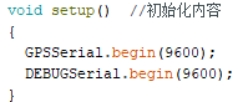
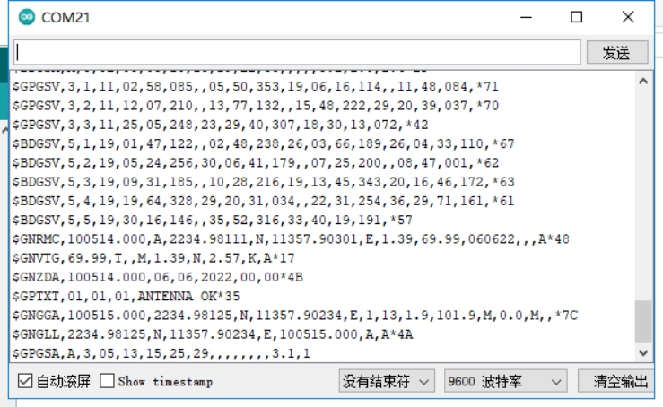

[English](../../en/03-arduino-position-read/position-read.md) | [Deutsch](../../de/03-arduino-position-read/position-read.md) | [Español](../../es/03-arduino-position-read/position-read.md) | [Français](../../fr/03-arduino-position-read/position-read.md) | [Italiano](../../it/03-arduino-position-read/position-read.md) | [日本語](../../ja/03-arduino-position-read/position-read.md) | [한국어](../../ko/03-arduino-position-read/position-read.md) | Português (BR) | [Português (PT)](../../pt-pt/03-arduino-position-read/position-read.md) | [简体中文](../../zh-hans/03-arduino-position-read/position-read.md) | [繁體中文](../../zh-hant/03-arduino-position-read/position-read.md)

**Leitura dos dados de posição do GPS**

**1. Objetivos**

Nesta lição usamos um Arduino e o módulo GPS para ler as informações de posição.

**2. Preparação**

O módulo GPS se comunica por UART e USB. Aqui usamos a UART do Arduino UNO: conecte o TX do módulo ao pino D0 do UNO, e o VCC e o GND aos 5 V e ao GND.

**3. Programa**

Inicialize a porta serial.

Imprima os dados recebidos.

**4. Compilar e enviar**

4.1 Abra o arquivo na Arduino IDE, clique no botão "✓" da barra de ferramentas para compilar e aguarde "Done compiling" na barra de status.

4.2 No menu da Arduino IDE, selecione Ferramentas → Porta → a porta mostrada no Gerenciador de Dispositivos, como abaixo.

4.3 Em seguida, clique no botão "→" para enviar o código para a placa UNO. Quando aparecer "Done uploading", o envio foi concluído com sucesso.

**5. Resultado**

Após a energização, o módulo leva cerca de 32 s para iniciar; depois disso, o LED de status da serial pisca continuamente e os dados podem ser recebidos normalmente.

Execute o programa, abra o monitor serial e defina o baud rate para 9600. As informações de posição atuais são impressas em loop. Estes são dados brutos, não processados — consulte a [especificação do protocolo CASIC GNSS](../../../docs/datasheets/CASIC-GNSS-protocol-spec-CN.pdf) para entender o significado de cada sentença.

Observe que a antena do módulo precisa estar ao ar livre, caso contrário pode não adquirir o sinal de GPS.
