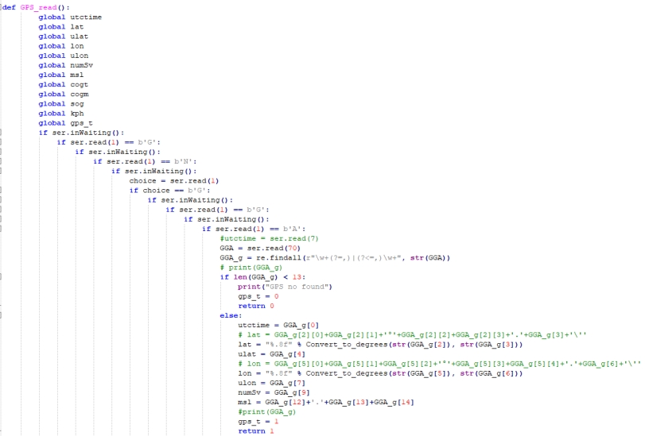
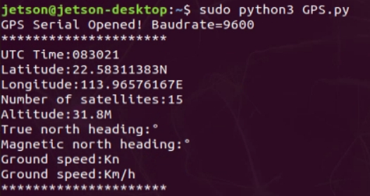
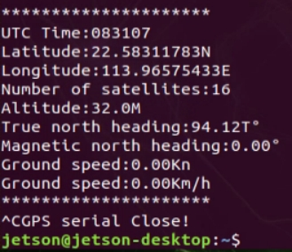

[English](../../en/06-jetson-nano-position-parse/position-parse.md) | [Deutsch](../../de/06-jetson-nano-position-parse/position-parse.md) | [Español](../../es/06-jetson-nano-position-parse/position-parse.md) | [Français](../../fr/06-jetson-nano-position-parse/position-parse.md) | [Italiano](../../it/06-jetson-nano-position-parse/position-parse.md) | [日本語](../../ja/06-jetson-nano-position-parse/position-parse.md) | [한국어](../../ko/06-jetson-nano-position-parse/position-parse.md) | [Português (BR)](../../pt-br/06-jetson-nano-position-parse/position-parse.md) | Português (PT) | [简体中文](../../zh-hans/06-jetson-nano-position-parse/position-parse.md) | [繁體中文](../../zh-hant/06-jetson-nano-position-parse/position-parse.md)

**Leitura e Análise de Dados de Posição GPS (Jetson)**

**1. Objetivos**

Nesta lição utilizamos um Jetson Orin e o módulo GPS para ler e analisar a informação de posição.

**2. Preparação**

O módulo GPS suporta comunicação por UART ou USB; aqui utilizamos USB.

Ligue o Jetson Orin ao módulo GPS com um cabo Type-C e, em seguida, execute `ls /dev | grep 'ttyUSB'` — o módulo é detetado como `USB0`.

**3. Programa**

O programa desta lição é `GPS.py`.

Inicialize o USB:

A função de aquisição e análise de posição filtra os dados recebidos à procura de frases que começam por `GNGGA` e analisa-as para variáveis globais.

A mesma abordagem lê e analisa a informação de rumo a partir de `GNVTG`.

Os dados analisados são impressos em ciclo.

**4. Executar o programa**

Execute `sudo python3 GPS.py` num terminal.

**5. Resultado**

Após a alimentação, o módulo precisa de cerca de 32 s para arrancar; a partir daí, o LED de estado da porta série pisca de forma contínua e os dados podem ser recebidos normalmente.

Quando o programa arranca, inicializa o USB e imprime `GPS Serial Opened! Baudrate=9600` em caso de sucesso, ou `GPS Serial Open Failed!` em caso de falha — se falhar, verifique as ligações ou a porta USB. Em seguida, imprime a informação de posição e de rumo em ciclo.

Prima Ctrl+C para parar a leitura.

Tenha em conta que a antena do módulo tem de estar ao ar livre, caso contrário pode não adquirir sinal GPS — quando não encontra sinal, imprime `GPS no found`.
