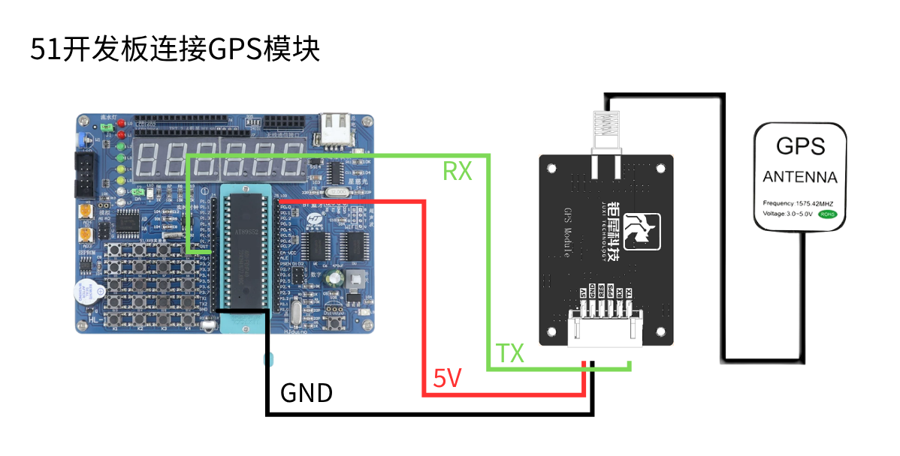
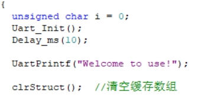
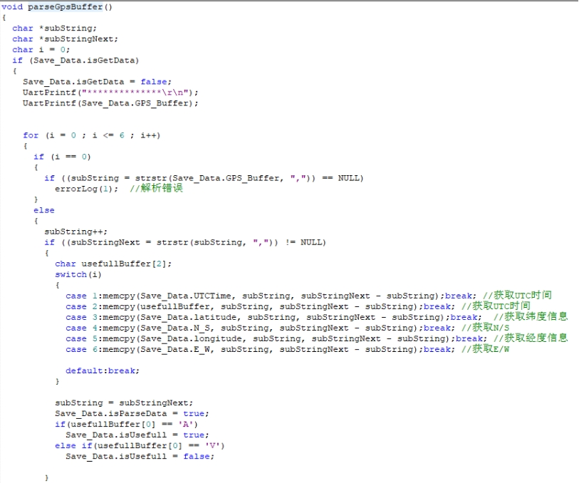

English | [简体中文](gps-data-parsing_CN.md)

**GPS Data Parsing**

**1. Objectives**

In this lesson we use an STC89C52RC (8051) microcontroller together with the GPS module to parse position information.

**2. Preparation**

The GPS module communicates over UART and USB. Here we read it through the 8051's UART: connect the module's TX to pin P3.0 of the 8051 board, and VCC and GND to 5 V and GND.

**3. Program**

Initialise the serial port and the data array.

Read and parse the incoming data.

Print the received data over the serial port.

**4. Result**

After power-up the module needs about 32 s to start; after that the serial status LED blinks continuously and data can be received normally.

Download and run the program, open a serial terminal at 9600 baud, and the current position information is printed in a loop.

Note that the module's antenna must be outdoors, otherwise it may not acquire a GPS signal.
