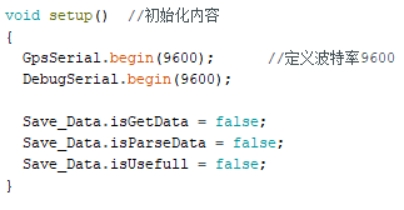
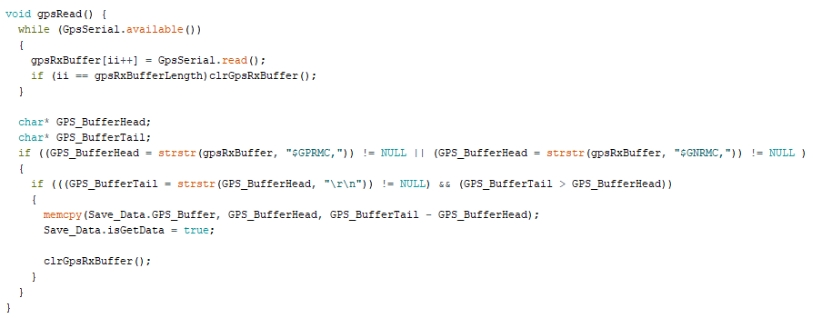
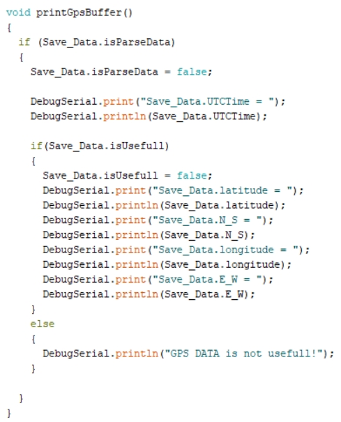
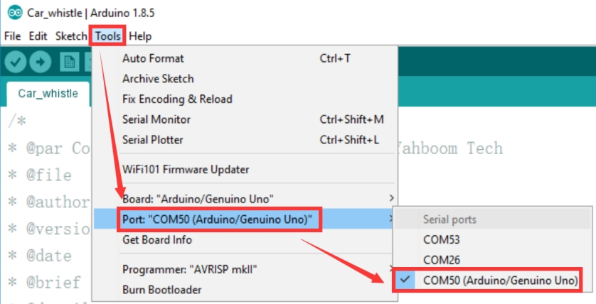
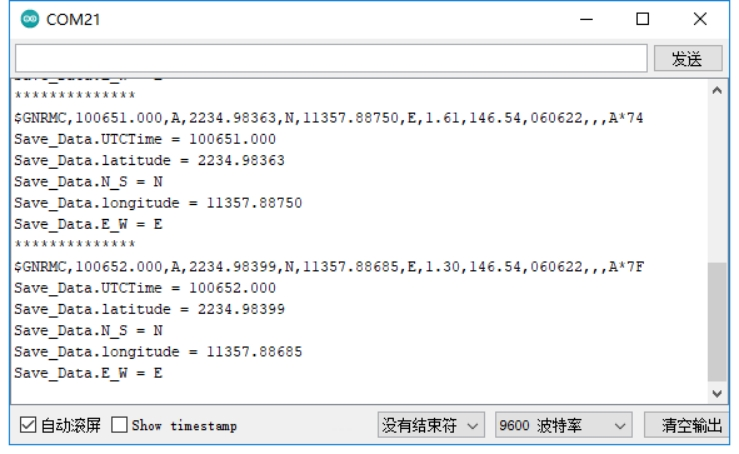

English | [简体中文](position-parse_CN.md)

**Parsing GPS Position Data**

**1. Objectives**

In this lesson we use an Arduino and the GPS module to parse position information and print it.

**2. Preparation**

The GPS module communicates over UART and USB. Here we use the Arduino UNO's UART: connect the module's TX to the UNO's D0 pin, and VCC and GND to 5 V and GND.

**3. Program**

Initialise the serial port.

Read the serial data.

Parse the serial data.

Print the parsed position information.

**4. Compile and upload**

4.1 Open the file in the Arduino IDE, click the "✓" button to compile, and wait for "Done compiling".

4.2 In the menu, select Tools → Port → the port shown in Device Manager.

4.3 Click the "→" button to upload. When "Done uploading" appears, the upload succeeded.

**5. Result**

After power-up the module needs about 32 s to start; after that the serial status LED blinks continuously and data can be received normally.

Run the program, open the serial monitor at 9600 baud, and the parsed real-time position information is printed in a loop.

Note that the module's antenna must be outdoors, otherwise it may not acquire a GPS signal.
