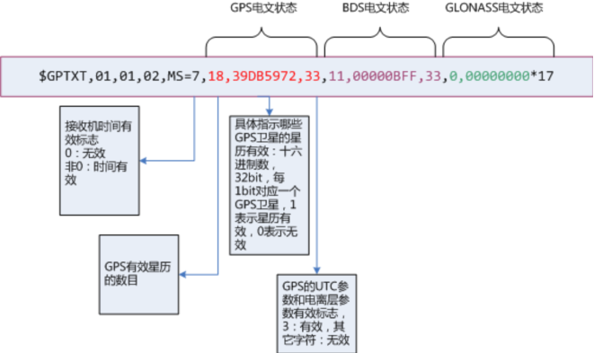
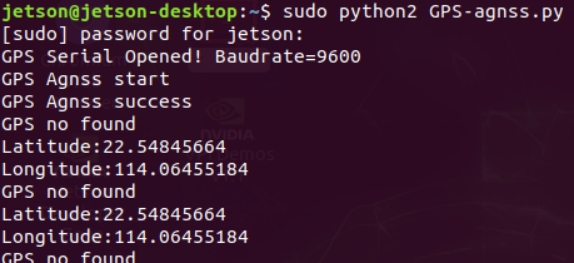

English | [简体中文](agnss_CN.md)

**AGNSS-Assisted Positioning**

**1. Objectives**

In this lesson we use a Jetson Orin, the GPS module and an AGNSS server to read and parse position information under weak-signal conditions.

**2. About AGNSS**

2.1 **Why AGNSS**

- A standalone GNSS receiver must acquire and track satellite signals and decode the navigation message before it can fix its position.
- In a strong-signal environment it can cold-start in about 30 seconds. In a weak-signal environment acquisition is slow and the navigation message is hard to decode, so a fix can take a very long time or never happen.
- AGNSS supplies the receiver with the assistance it needs — navigation data, an approximate position and time. In both strong and weak signal conditions this significantly shortens time to first fix (TTFF).

2.2 **How it works**

- An AGNSS server collects and manages assistance data from several GNSS sources, and answers client requests (which require a username and password).
- The client fetches the assistance data over TCP/IP and forwards it to the GNSS receiver.
- You can also run your own proxy server.

2.3 **Procedure**

- Connect to the AGNSS server
  - Address: `121.41.40.95` (domain `www.gnss-aide.com`)
  - Port: `2621`
- Send an AGNSS request
  - Request string (username and password are required):
  - `user=<your-username>;pwd=<your-password>;cmd=full;gnss=gps+bd;lat=60.0;lon=55.0;alt=0;`
- Receive the assistance data
- Forward it to the receiver

2.4 **Request parameters**

The request is a sequence of `key=value;` pairs, for example `key=value;key=value;`.

Example: `user=<your-username>;pwd=<your-password>;cmd=full;gnss=gps+bd;lat=60.0;lon=55.0;alt=0;`

| Key | Value | Required | Notes |
| --- | --- | --- | --- |
| **user** | string | yes | Username. It is strongly recommended to use a valid email address — important AGNSS server maintenance notices are sent there. |
| **pwd** | string | yes | User password |
| **gnss** | string | no | Comma-separated GNSS list; currently GPS is supported. Valid values are `gps`, `bds`, `glo`. `gnss=gps;` requests GPS assistance, `gnss=gps,bds;` requests GPS and BDS assistance. |
| **cmd** | string | no | `full`: all information, including ephemeris, estimated time and position. `eph`: ephemeris only. `aid`: assistance time and position. Defaults to `full`. |
| **lat** | number | no | Estimated latitude of the user, in degrees (-90 to 90). Position assistance comes in two formats — lat/lon/alt or ECEF — and you pick one. The lat/lon/alt format requires all three fields: `lat=30;lon=120.3;alt=100;` |
| **lon** | number | no | Estimated longitude of the user, in degrees (-180 to 180). |
| **alt** | number | no | Estimated altitude of the user, in metres. |
| **x** | number | no | Estimated ECEF X of the user, in metres. The ECEF format requires all three fields: `x=30000;y=1111120.3;z=3345100;` |
| **y** | number | no | Estimated ECEF Y of the user, in metres. |
| **z** | number | no | Estimated ECEF Z of the user, in metres. |
| **pacc** | number | no | Accuracy of the user position, in metres. |

2.5 **Server response**

- The server returns a data header followed by the assistance data.
- The binary payload is the assistance data the receiver needs, and carries its own checksum. For the binary format see the CASIC receiver protocol specification.
- Forwarding the header to the receiver as well is harmless.

2.6 **Performance**

Compared with a standalone GNSS receiver, an AGNSS receiver improves TTFF significantly, especially in weak-signal conditions.

2.7 **Notes**

- The approximate position must be obtained some other way, for example from:
  - a GSM/GPRS/3G module, which can derive a rough position from the cell ID
  - Wi-Fi or another wireless module, which can also locate roughly
- The approximate position must be accurate to within 15 km; a wrong position hint degrades receiver performance.
- If no approximate position is available, omit the position fields (lat, lon, alt, x, y, z) from the request — the receiver then falls back to its last valid fix.
- There is no need to use the receiver's own output as the approximate position.

2.8 **When AGNSS is needed**

There is no need to download from the server on every boot, which saves bandwidth:

- CASIC chips have a battery-backed SRAM and a permanent backup flash that retain received ephemeris data.
- While running normally the chip keeps downloading the latest ephemeris from the satellites.
- You can query the receiver's status to decide whether a download is needed. The receiver can output a navigation-message status sentence (off by default; it must be configured).

2.9 **The navigation-message status sentence**

- This sentence reports the receiver's internal time and navigation-message status.
- Send `$PCAS03,,,,,,,,,,,1*1F` to output it once per second.
- Send `$PCAS03,,,,,,,,,,,0*1E` to stop outputting it.
- Note: every sentence must end with `\r\n` (0x0D, 0x0A), and contains 11 commas.
- If the time flag is valid (non-zero) and the number of valid ephemerides is large (more than 8), there is no need to download AGNSS ephemeris.

**3. Preparation**

**3.1 Wiring**

The GPS module supports UART or USB communication; here we use USB.

Connect the Jetson Orin to the GPS module with a Type-C cable, then run `ls /dev | grep 'ttyUSB'` — the module is detected as `USB0`.

**3.2 Getting a Baidu Map AK**

See [Applying for a Baidu Map API Key](baidu-map-api-key.md).

**4. Program**

The program for this lesson is `GPS-agnss.py`.

Initialise USB:

Fill in the AK you applied for, and the current approximate latitude and longitude can then be read from Baidu Maps.

The approximate coordinates from Baidu Maps are sent to the server — use your own AGNSS account — and once complete the whole packet is sent to the module.

The position acquisition and parsing function filters the incoming data for sentences starting with `GNGGA` and parses them into global variables.

The same approach reads and parses the heading information from `GNVTG`.

The parsed data is printed in a loop.

**5. Running the program**

Run `sudo python2 GPS-agnss.py` in a terminal.

**6. Result**

**Note: with assisted positioning the Jetson Orin must have network access.**

After power-up in a weak-signal environment the program initialises USB and prints `GPS Serial Opened! Baudrate=9600` on success, or `GPS Serial Open Failed!` on failure — if it fails, check the wiring or the USB port.

It then prints `GPS Agnss start` while sending the assistance data to the server, and `GPS Agnss success` when done.

Until a GPS signal is acquired it prints `GPS no found` along with the approximate coordinates read from Baidu Maps.

Once the signal is acquired it prints position and heading information in a loop.

Press Ctrl+C to stop reading.
