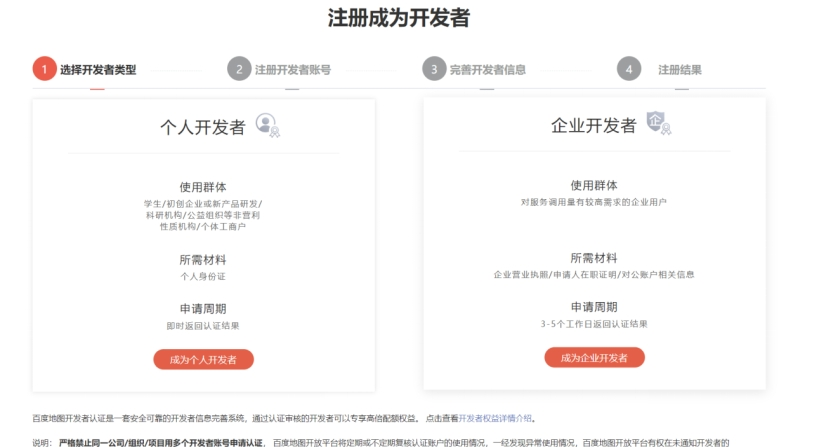
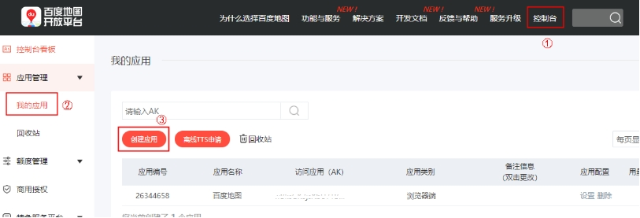
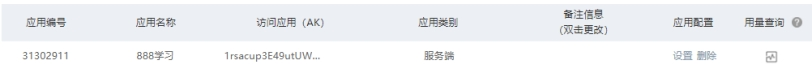
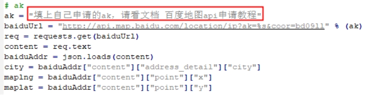

[English](baidu-map-api-key.md) | 简体中文

**百度地图api申请教程**

**1.** **注册方法**

进入百度地图开放平台https://lbsyun.baidu.com/

滑动到页面底端

点击立即注册

 

建议选择成为个人开发者（因为当天申请即可使用）

按照提示一步步完成即可

 

**2. 获取ak**

我们使用的是web服务里的 普通IP定位，文档可在下面的连接查阅。

https://lbsyun.baidu.com/index.php?title=webapi/ip-api

点击 控制台，选择 我的应用，选择 创建应用。

 

应用名随便写，应用类型选择 服务器端 ，启用服务，白名单输入一个 0.0.0.0/0。

 

点击 提交 生成一个应用。

 

复制我们应用的ak值

 

粘贴在程序里，保存，即可通过百度地图读取到位置信息。

 