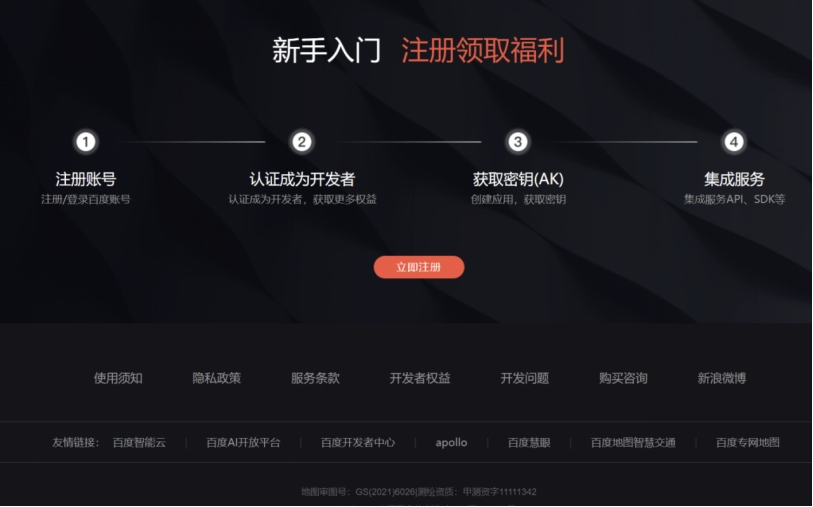

English | [简体中文](baidu-map-api-key_CN.md)

**Applying for a Baidu Map API Key**

**1. Registration**

Go to the Baidu Map open platform: <https://lbsyun.baidu.com/>

Scroll to the bottom of the page and click "Register now".

Registering as an individual developer is recommended, since the key can be used the same day.

Follow the prompts to complete registration.

**2. Getting the AK**

The service used here is the IP location service from the Web Service API. Its documentation is at:

<https://lbsyun.baidu.com/index.php?title=webapi/ip-api>

Click **Console**, choose **My Applications**, then **Create Application**.

Give the application any name, choose **Server side** as the application type, enable the service, and enter `0.0.0.0/0` in the whitelist.

Click **Submit** to create the application.

Copy the application's AK value.

Paste it into the program and save — you can then read position information through Baidu Maps.

