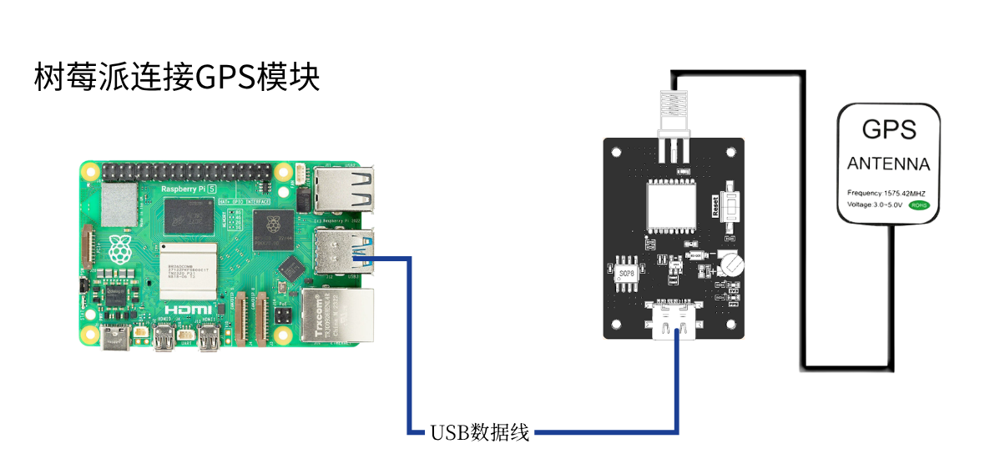
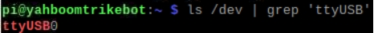
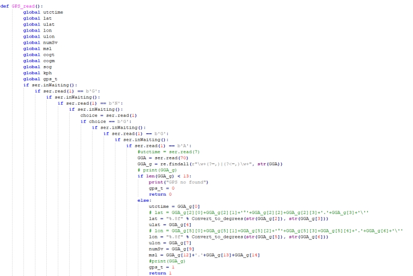
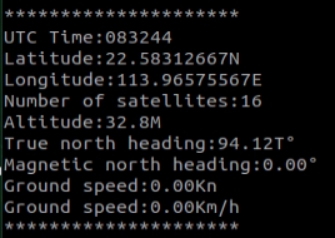

English | [简体中文](position-parse_CN.md)

**Reading and Parsing GPS Position Data (Raspberry Pi)**

**1. Objectives**

In this lesson we use a Raspberry Pi and the GPS module to read and parse position information.

**2. Preparation**

The GPS module supports UART or USB communication; here we use USB.

Connect the Raspberry Pi to the GPS module with a Type-C cable, then run `ls /dev | grep 'ttyUSB'` — the module is detected as `USB0`.

**3. Program**

The program for this lesson is `GPS.py`.

Initialise USB:

The position acquisition and parsing function filters the incoming data for sentences starting with `GNGGA` and parses them into global variables.

The same approach reads and parses the heading information from `GNVTG`.

The parsed data is printed in a loop.

**4. Running the program**

Run `sudo python2 GPS.py` in a terminal.

**5. Result**

After power-up the module needs about 32 s to start; after that the serial status LED blinks continuously and data can be received normally.

When the program starts it initialises USB and prints `GPS Serial Opened! Baudrate=9600` on success, or `GPS Serial Open Failed!` on failure — if it fails, check the wiring or the USB port. It then prints position and heading information in a loop.

Press Ctrl+C to stop reading.

Note that the module's antenna must be outdoors, otherwise it may not acquire a GPS signal — when no signal is found it prints `GPS no found`.
