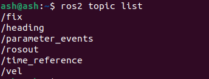
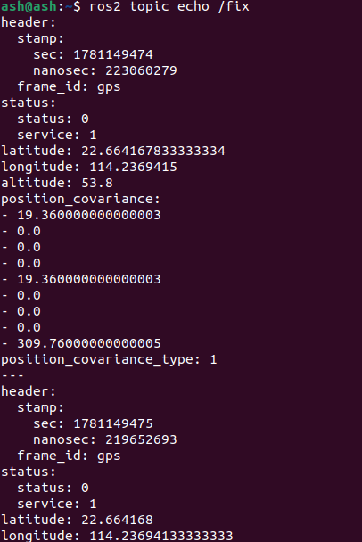

English | [简体中文](02-read-gps-data_CN.md)

### Reading GPS Module Data

**This feature reads GPS data from a terminal and parses it into latitude, longitude and altitude.**

#### 1. Reading GPS data from a terminal

In a terminal:

```
ros2 launch nmea_navsat_driver nmea_serial_driver.launch.py
```


Now look at the topics:

```
ros2 topic list
```



A note on the GPS topics:

| Topic | Type | Description |
| --- | --- | --- |
| `/extend_fix` | `gps_common/GPSFix` | GPSFix message containing satellite status and fix information |
| `/fix` | `sensor_msgs/NavSatFix` | GPS fix information |
| `/time_reference` | `sensor_msgs/TimeReference` | GPS time information |
| `/vel` | `geometry_msgs/TwistStamped` | GPS velocity |

The message definitions are documented at:

[sensor_msgs/NavSatFix Documentation (ros.org)](http://docs.ros.org/en/api/sensor_msgs/html/msg/NavSatFix.html)

[sensor_msgs/TimeReference Documentation (ros.org)](http://docs.ros.org/en/api/sensor_msgs/html/msg/TimeReference.html)

[geometry_msgs/TwistStamped Documentation (ros.org)](http://docs.ros.org/en/api/geometry_msgs/html/msg/TwistStamped.html)

You can print these topic messages in a terminal — what you get is the GPS data. For example, to print `/fix`:

```
ros2 topic echo /fix
```

The terminal prints:



Here `latitude`, `longitude` and `altitude` are the latitude, longitude and altitude.

#### 2. Reading latitude, longitude and altitude

In a terminal:

```
ros2 launch nmea_navsat_driver nmea_serial_driver.launch.py
```

In another terminal:

```
ros2 run nmea_navsat_driver read_lat_long.py
```


The printed data is the current latitude, longitude and altitude. Have a look at the source, `read_lat_long.py`:

```python
#! /usr/bin/env python3
# -*- coding: utf-8 -*-
import rclpy
from rclpy.node import Node
from sensor_msgs.msg import NavSatFix

class GPSSubscriber(Node):
    def __init__(self):
        super().__init__('GPS_subscriber')
        self.subscription = self.create_subscription(
            NavSatFix,
            '/fix',
            self.gps_callback,
            10)
        self.subscription

    def gps_callback(self, msg):
        self.get_logger().info(f"latitude:{msg.latitude:.6f}, longitude:{msg.longitude:.6f}, altitude:{msg.altitude:.6f}")

def main(args=None):
    rclpy.init(args=args)
    gps_subscriber = GPSSubscriber()
    rclpy.spin(gps_subscriber)
    gps_subscriber.destroy_node()
    rclpy.shutdown()

if __name__ == '__main__':
    main()
```

The program subscribes to `/fix`, parses the message in the callback, and prints it to the terminal.
