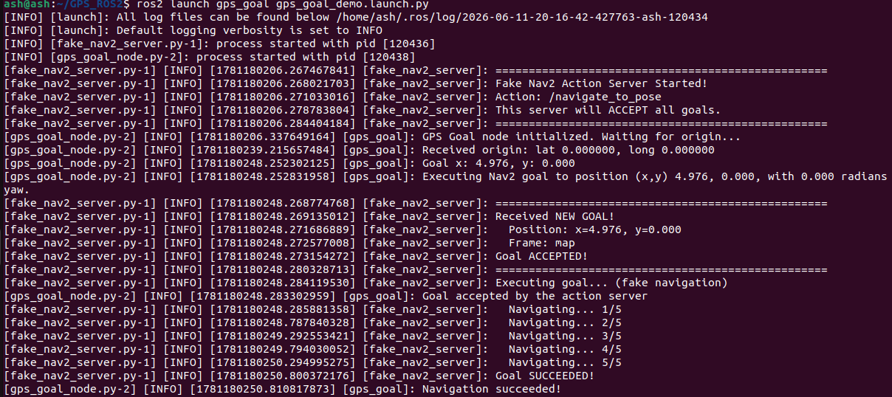
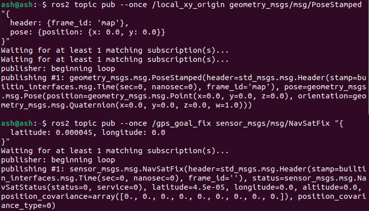

English | [简体中文](05-gps-nav2_CN.md)

### GPS and Nav2 Navigation

**To navigate to a given latitude/longitude with Nav2 you cannot send the goal directly — the coordinates first have to be converted into Nav2 goal xy values. This section explains that conversion.**

#### 1. Running it

Nav2 must already be running. A blank map can be loaded, but the origin and goal coordinates must lie inside that map — otherwise the program warns `The goal sent to the planner is off the global costmap. Planning will always fail to this goal`, meaning the planner will never reach it. Starting Nav2 is not covered here; we assume it is already up.

With Nav2 running, in a terminal:

```
ros2 launch gps_goal gps_goal.launch.py
```

- Give the origin latitude/longitude (where am I?)

```
ros2 topic pub /local_xy_origin geometry_msgs/msg/PoseStamped "{header: {frame_id: 'map'}, pose: {position: {x: 43.658, y: -79.379}}}" -1
```

This publishes on the `/local_xy_origin` topic. The x and y values are examples and should be set to match your situation.

After running it the terminal prints `Received origin: lat -79.379, long 43.658`.



- Give the goal latitude/longitude (where am I going?)

```
ros2 topic pub /gps_goal_fix sensor_msgs/msg/NavSatFix "{latitude: 2.548, longitude: 11.06455}" -1
```

This publishes on `/gps_goal_fix`. These coordinates are also examples.

After running it the terminal prints:

```
[INFO] [gps_goal_node]: The distance from the origin to the goal is 9284767.487 m.
[INFO] [gps_goal_node]: The azimuth from the origin to the goal is -32.818 degrees.
[INFO] [gps_goal_node]: The translation from the origin to the goal is (x,y) 7802896.906, -5032067.881 m.
Goal x:  7802896.905971293
Goal y:  -5032067.881259187
[INFO] [gps_goal_node]: Executing Nav2 goal to position (x,y) 7802896.906, -5032067.881, with 0 degrees yaw.
[INFO] [gps_goal_node]: To cancel the goal: 'ros2 action send_goal /navigate_to_pose nav2_msgs/action/NavigateToPose --cancel'
[INFO] [gps_goal_node]: Initial goal status: ACCEPTED
[INFO] [gps_goal_node]: This goal has been accepted by the action server
[INFO] [gps_goal_node]: Final goal status: ABORTED
[INFO] [gps_goal_node]: Failed to find a valid plan. Even after executing recovery behaviors.
```



From the output: the distance between the two points is **9284767.487 m** (because the coordinates given differ enormously) and the azimuth is **-32.818°**. The converted goal xy value is (7802896.906, -5032067.881) — clearly far outside the map, so planning can never reach it. That is why the earlier note matters: **the origin and goal coordinates must lie inside the map.** Once the xy values are computed they are packaged and sent to Nav2 for planning.

#### 2. About the source

Source path: `src/gps_goal/gps_goal/gps_goal.py` in the workspace.

The code is simple — look at the main function:

```python
gps_goal_node = GpsGoalNode()  # create the object
lat, long = DMS_to_decimal_format(lat, long)  # parse the coordinates: from the command line and from the topic
gps_goal_node.do_gps_goal(lat, long, roll=roll, pitch=pitch, yaw=yaw)
```

The `do_gps_goal` function:

```python
def do_gps_goal(self, goal_lat, goal_long, z=0, yaw=0, roll=0, pitch=0):
    # Calculate goal x and y in the frame_id given the frame's origin GPS and a goal GPS location
    # convert lat/long into xy in the Nav2 map
    x, y = calc_goal(self.origin_lat, self.origin_long, goal_lat, goal_long)
    print("Goal x: ", x)
    print("Goal y: ", y)
    self.publish_goal(x=x, y=y, z=z, yaw=yaw, roll=roll, pitch=pitch)
```

`calc_goal` computes the xy values from the origin and goal coordinates. `publish_goal` packages the xy values as a `NavigateToPose.Goal()` message and sends it over an action.

## Testing with a fake Nav2 server

Open a terminal:

```
cd ~/GPS_ROS2
```

```
ros2 launch gps_goal gps_goal_demo.launch.py
```

Open a new terminal:

```
# set the origin
ros2 topic pub --once /local_xy_origin geometry_msgs/msg/PoseStamped "{
  header: {frame_id: 'map'},
  pose: {position: {x: 0.0, y: 0.0}}
}"
```

```
# set the goal (5 metres north)
ros2 topic pub --once /gps_goal_fix sensor_msgs/msg/NavSatFix "{
  latitude: 0.000045, longitude: 0.0
}"
```
