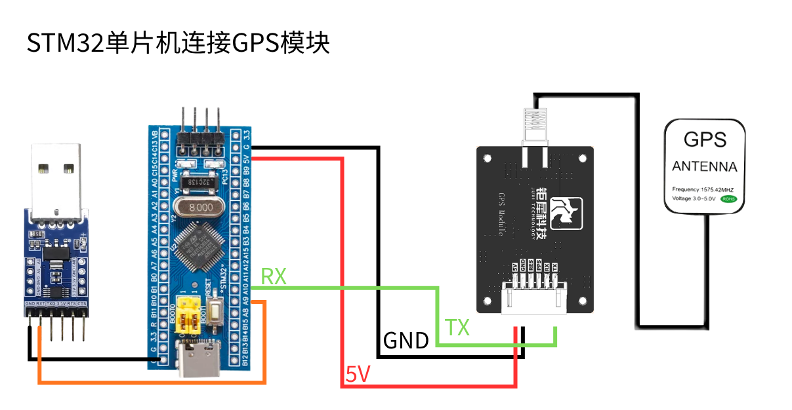
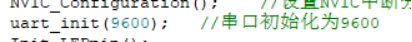
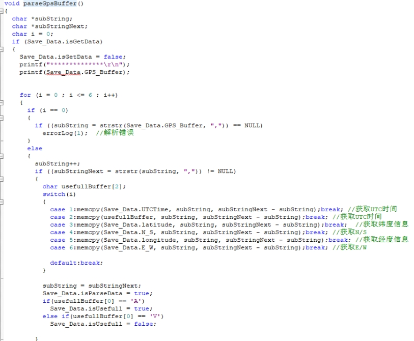

English | [简体中文](gps-parse-output_CN.md)

**Parsing and Outputting GPS Data (STM32)**

**1. Objectives**

In this lesson we use an STM32F103C8T6 and the GPS module to parse and output position information.

**2. Preparation**

The GPS module communicates over UART and USB. Here we use the STM32's UART: connect the module's TXD to pin PA10 of the STM32F103C8T6 board, and VCC and GND to the board's 5 V and GND. Connect the TTL adapter's GND and RXD to the STM32's GND and PA9.



**3. Program**

The module's baud rate is 9600.



Read and parse the incoming data.



Convert the latitude / longitude units to degrees.


Print the received data over the serial port.


Note: latitude and longitude from GPS / BeiDou are not a simple ×100 relationship — they need a degrees-minutes conversion. For example, for latitude `2429.53531` N and longitude `11810.78036` E:

```
24 + (29.53531 / 60) ≈ 24.49225517
118 + (10.78036 / 60) ≈ 118.17967267
```

Different microcontrollers may also introduce a small error because of data-conversion precision.

**4. Result**

After power-up the module needs about 32 s to start; after that the serial status LED blinks continuously and data can be received normally.

Download and run the program, open a serial terminal at 9600 baud, and the current position information is printed in a loop.


Note that the module's antenna must be outdoors, otherwise it may not acquire a GPS signal.
